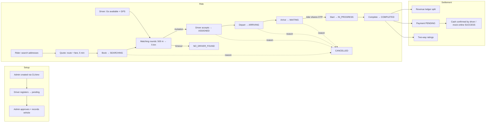
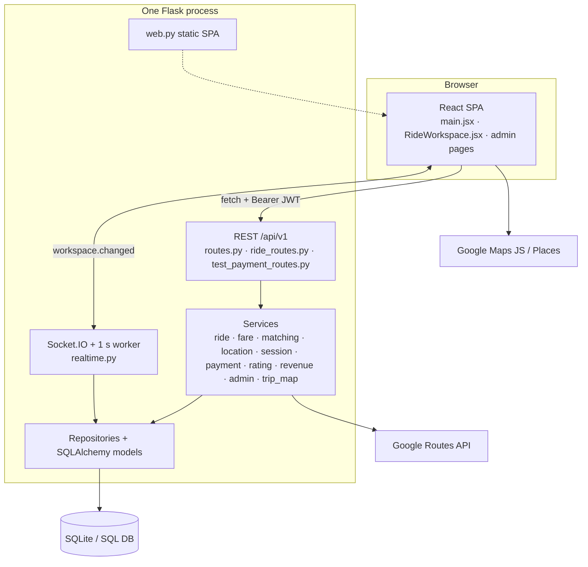

# 00 — Project overview

[← Back to index](README.md) · Next: [01 — Technology stack →](01-technology-stack.md)

## What the application does

**ridez.io** is a web-based taxi booking platform (think a small, self-hosted ride-hailing service) with three role-specific workspaces in one React single-page app:

- **Riders** search pickup/destination addresses, receive an itemized, locked fare quote, book a ride, follow the matched driver live on a map, share a per-ride OTP at pickup, pay (cash, or a simulated "online" QR payment), and rate the driver.
- **Drivers** register and wait for admin approval, go "available" while sharing browser GPS, receive ride invitations within an expanding radius, accept or reject them, progress the trip (head to pickup → arrive → start with OTP → complete), confirm cash payments, see earnings, and rate the rider.
- **Admins** approve, suspend and reinstate drivers, record vehicle details, configure versioned INR fare rules and surge, configure effective-dated driver/company revenue splits, monitor live metrics, and browse an audit history.

The backend is a single Flask process that serves the REST API under `/api/v1`, a Socket.IO server for push notifications, a 1-second background loop that drives matching deadlines, and (in production) the compiled React app itself.

## What problem it solves

Matching a passenger with a nearby, available, approved driver, agreeing on a fair price up front, and carrying the trip safely to completion with an auditable money split. Specifically, the code addresses:

| Problem | How the code addresses it |
| --- | --- |
| Price disputes | Fare is computed server-side and stored as an **immutable quote** (`fare_quotes`), including the policy version and surge reason. The ride uses the quote total; later rate changes cannot reprice it. |
| Finding a driver | **Expanding-radius matching**: 500 m, +500 m every 30 s, up to `MATCH_MAX_RADIUS_M` (default 5 km), only for drivers with GPS fresher than 90 s (`app/matching.py`). |
| Double booking | Database uniqueness on `active_rides.user_id` and **conditional UPDATEs** ensure one driver per ride and one ride per person even under concurrency. |
| Wrong passenger / wrong car | **Per-ride OTP** the driver must enter to start the trip; vehicle details are **snapshotted** onto the ride at acceptance. |
| Driver earnings transparency | Revenue split recorded once per completed ride in `revenue_ledger`; earnings count as "received" only once payment is confirmed. |
| Operational control | Admin approval, suspension with visible reasons, audit trail of every admin change. |

## Primary objectives (as reflected in code and `docs/PRODUCT_BLUEPRINT.md`)

1. A complete, working ride lifecycle from quote to settlement.
2. Correctness under concurrency (competing acceptances, cancellations racing completions, etc.).
3. Honest labelling: simulated routes, test payments and allocations are always labelled as such in the UI and API (e.g. `test_only: true`, "Allocation recorded · not a payment").
4. Privacy: riders never see revenue splits; drivers never see the rider's OTP; admins never see precise driver coordinates; people never see comments written about them.

## Users and roles

| Role | How the account is created | Initial status | What they can do |
| --- | --- | --- | --- |
| `rider` | Public registration (`POST /api/v1/auth/register`) | `active` | Quote, book, cancel, pay, rate, view history |
| `driver` | Public registration with role `driver` | `pending` | Sign in and view workspace; after approval: go available, accept rides, progress trips, confirm cash, rate riders, view earnings |
| `admin` | **Only** CLI `flask create-admin` or `flask bootstrap-admin` (env vars). Public registration rejects `admin`. | `active` | All admin pages and endpoints; can view any ride |

Account `status` values (`users.status`): `active`, `pending`, `suspended` (drivers only, enforced by CHECK constraint), `disabled`. **Note:** no code path or endpoint sets `disabled`; it can only be set directly in the database. Disabled users cannot log in, refresh, or use tokens.

## Main features

| Feature | Status |
| --- | --- |
| Mobile + password registration/login, permanent account codes | Implemented |
| Persistent sessions (15-min JWT + rotating 30-day HttpOnly refresh cookie), logout, logout all devices | Implemented |
| Driver approval / suspension / reinstatement with audit | Implemented |
| Admin-recorded vehicle details, snapshotted on each ride | Implemented |
| Driver GPS availability with freshness, replay and plausibility checks | Implemented (browser tab must stay open) |
| Google Places address autocomplete + map click selection | Implemented (needs browser key) |
| Route + fare quotes (Google Routes or deterministic simulator) | Implemented |
| Versioned fare policy with zone/traffic/demand surge | Implemented |
| Expanding-radius matching with persistent rounds | Implemented |
| Accept/reject, trip lifecycle, per-ride OTP | Implemented |
| Pre-trip cancellation with reasons | Implemented |
| Revenue allocation with effective-dated splits | Implemented |
| Payment method choice, driver cash confirmation | Implemented |
| "Online" payment | **Simulated only** — mock QR page, no bank/UPI integration |
| Two-way star ratings with tags and admin-only comments | Implemented |
| Live Google trip map and ETA card | Implemented for Google-mode rides |
| Real-time updates (Socket.IO + outbox) with polling fallback | Implemented |
| Admin metrics dashboard and audit history | Implemented |
| Profile editing, account recovery, password reset | **Not implemented** (UI says "later milestone") |
| SMS OTP, native background tracking, real payments, refunds, incident handling | **Not implemented** |
| Multi-instance scaling (Redis, shared rate limits) | **Not implemented**; system must run as one process |

## Overall application workflow

## Technology stack at a glance

| Layer | Technology |
| --- | --- |
| Frontend | React 19, React Router 7, Vite 6, socket.io-client 4, lucide-react icons, qrcode |
| Backend | Python 3.12, Flask 3.1, Flask-SQLAlchemy 3.1 / SQLAlchemy 2.1, Flask-Migrate (Alembic), Flask-SocketIO 5 (threading mode), PyJWT, phonenumbers, requests |
| Database | SQLite in development and in the Render deployment; SQL Server (pyodbc) targeted but **not validated** |
| External | Google Routes API (server), Google Maps JavaScript API + Places API (New) (browser) |
| Runtime | Gunicorn (1 worker, gthread, 100 threads) in Docker on Render with a persistent disk |
| CI | GitHub Actions: pytest, Vite build, Docker build, container smoke test |

Full rationale: [01 — Technology stack](01-technology-stack.md).

## How the major systems work together

1. The browser loads the SPA (from Vite in development, or from Flask's `web.py` in production).
2. The SPA restores the session by calling `POST /api/v1/auth/refresh` with the HttpOnly cookie, getting a 15-minute JWT that lives only in memory.
3. Every screen is driven by one authoritative JSON snapshot, `GET /api/v1/workspace`, assembled by `ride_service.snapshot()` according to role.
4. User actions call specific endpoints (quote, book, accept, …). Each handler validates, performs conditional writes, inserts **outbox events** for every affected user, and commits.
5. The background loop (every second) advances matching deadlines and turns outbox rows into Socket.IO `workspace.changed` messages. Clients receiving one simply re-fetch `/workspace`. If the socket is down, clients poll every 2 seconds.
6. Fare quotes and live trip maps call Google Routes from the server; address search and map tiles call Google from the browser.

## High-level architecture diagram

More diagrams: [diagrams/architecture.md](diagrams/architecture.md).
