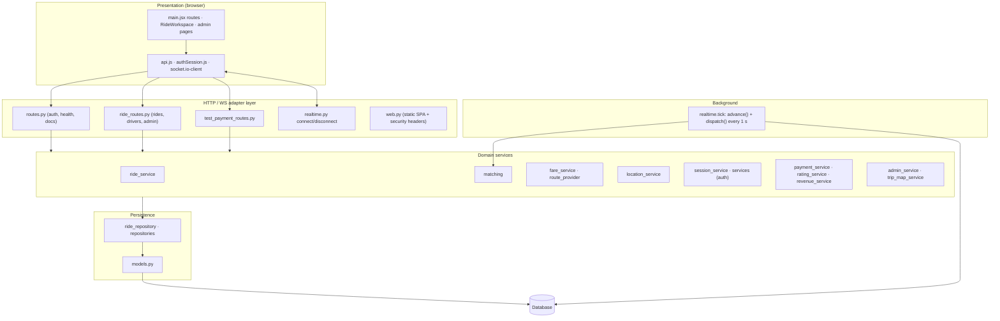
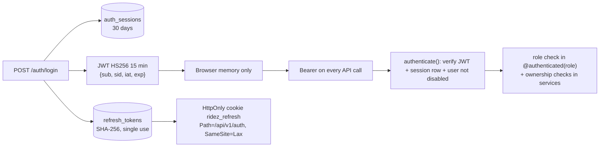
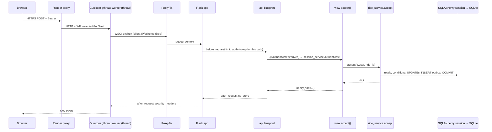

# 03 — System architecture

[← Back to index](README.md) · Next: [04 — Frontend documentation →](04-frontend-documentation.md)

## 1. Architectural style in one paragraph

ridez.io is a **modular monolith**: one Python process hosts the REST API, the WebSocket server, the background matching worker and (in production) the static SPA. Inside the process, code is layered as **HTTP adapters → domain services → repositories → SQLAlchemy models**. The database is the single source of truth for every piece of business state, including matching deadlines and outgoing notifications, so the process can restart at any time and catch up. Correctness under concurrency is achieved with **conditional UPDATE statements** and **primary-key uniqueness**, not with in-memory locks. The browser treats every push message as a hint and re-reads one authoritative snapshot (`GET /workspace`).

## 2. Frontend architecture

- **Single bundle SPA** built by Vite; entry `frontend/src/main.jsx`.
- **Routing**: React Router with role-prefixed trees `/rider/*`, `/driver/*`, `/admin/*` guarded by `Protected`, plus public `/`, `/login`, `/register`, `/test-payment/:token`.
- **Session**: a module-level store (`authSession.js`) holds the access token **in memory only**. The refresh credential is an HttpOnly cookie the JS cannot read. `AuthProvider` exposes it via React context.
- **Data**: one hook, `useWorkspace(token)`, owns the role snapshot. All mutations go through `perform()` (POST) or direct `api()` calls in admin pages, then trigger a refresh.
- **Real-time**: one Socket.IO connection per mounted workspace, authenticated with the access token.
- **Maps**: Google Maps JS loaded lazily by `googleMaps.js` only when a map or address search mounts.

Details: [04 — Frontend](04-frontend-documentation.md), [12 — State management](12-state-management.md).

## 3. Backend architecture

| Layer | Modules | Rules followed |
| --- | --- | --- |
| Entry | `run.py` (dev), `wsgi.py` + `gunicorn.conf.py` (prod) | Exactly one process |
| App factory | `app/__init__.py` | Config + validation + wiring |
| Adapters | `routes.py`, `ride_routes.py`, `test_payment_routes.py`, `web.py`, `realtime.py` handlers | Parse request, enforce authentication/role, call one service, `jsonify` |
| Services | `ride_service`, `matching`, `fare_service`, `route_provider`, `location_service`, `session_service`, `services`, `payment_service`, `rating_service`, `revenue_service`, `admin_service`, `trip_map_service` | Validation, business rules, transactions (commit/rollback), outbox notifications |
| Repositories | `ride_repository`, `repositories` | Query helpers and conditional writes |
| Models | `models.py` | Schema + `public()` serializers |

Transaction ownership: **services commit**. Repositories never commit except `repositories.save`. Adapters commit only in one place (`ride_routes.location` calls `repo.commit()` after `location_service.update`).

Details: [05 — Backend](05-backend-documentation.md).

## 4. Database architecture

- 19 tables (see [07 — Database](07-database-documentation.md)), all created by Alembic.
- Natural "one-row" tables keyed by user (`driver_presence`, `driver_locations`, `driver_vehicles`, `active_rides`) and by ride (`revenue_ledger`, `ride_payments`, `mock_payments`).
- Append-only/versioned history tables: `fare_policies`, `revenue_share_settings`, `admin_audit`, `ride_match_rounds`.
- Timestamps are stored as **naive UTC** (`datetime.now(timezone.utc).replace(tzinfo=None)`) and serialized with a trailing `Z`. Exception: `users.created_at` is declared timezone-aware.
- Money is `Numeric(10,2)` and handled as Python `Decimal` with `ROUND_HALF_UP`; serialized as strings (`"352.08"`) to avoid float rounding in JSON.

## 5. API architecture

- REST over JSON under `/api/v1`, one Flask Blueprint (`api`).
- Authentication by `Authorization: Bearer <JWT>` for all business endpoints; cookie-based only for `/auth/refresh`, `/auth/logout`, `/auth/logout-all`.
- Uniform error envelope: `{"error": "<human message>"}` with an HTTP status (400, 401, 403, 404, 409, 410, 422, 429, 502, 503, 504).
- Idempotency: booking keyed by `quote_id`; accept, transitions, cancel, reject, payment choice, cash confirmation, rating (same stars), driver review and mock payment all return the current state on exact retries.
- Optimistic concurrency with explicit `version` fields: fare policy, revenue share, driver status (`status_revision`), vehicle.
- Caching: every API response is `Cache-Control: no-store`.
- Documentation: `/api/v1/openapi.json` and `/api/v1/docs` (partial; see [06 — API](06-api-documentation.md)).

## 6. Authentication and authorization architecture

Two layers of authorization:
1. **Role gate** in `routes.authenticated(role)` (e.g. only riders may quote/book).
2. **Ownership/state checks** inside services (`ride_service.accessible`, `payment_service.choose` checks `ride.rider_id`, `move` checks assigned driver, etc.). Not-owned resources return **404** to avoid revealing their existence.

Details: [08 — Authentication and security](08-authentication-and-security.md).

## 7. External service integrations

| Integration | Direction | Trigger |
| --- | --- | --- |
| Google Routes `computeRoutes` | Server → Google | Every quote in Google mode; trip map refresh (cached 60 s per ride/phase/source/target) |
| Google Maps JS + Places (New) | Browser → Google | Booking map, address search, trip map |
| Browser Geolocation | Browser | Driver availability/location loop; rider "Use my location" |

## 8. Communication between modules (who calls whom)

| Caller | Callee | Why |
| --- | --- | --- |
| Every request through `ride_service.expire()` | `matching.advance()` | Catch up overdue rounds before reading state |
| `ride_service.quote` | `route_provider.compute`, `fare_service.calculate` | Route then price |
| `ride_service.book` | `matching.invite` | First round invitations |
| `ride_service.move('complete')` | `revenue_service.allocate`, `payment_service.record_completion`, `location_service.is_fresh` | Settlement + auto-availability |
| `ride_service.public` | `rating_service.summary/given/for_admin` | Ratings on ride JSON |
| `ride_service.snapshot` | `admin_service.metrics`, `location_service.public` | Admin and driver data |
| `admin_service.change_driver_status` | `session_service.stop_requests` | Suspension stops new work |
| `session_service.logout` | `realtime.disconnect_invalid` | Kick revoked sockets |
| `trip_map_service.trip_map` | `ride_service.accessible`, `route_provider.compute` | Participant check + route |
| `test_payment_routes.simulate_test_payment` | `payment_service.confirm` | Online confirmation |
| All mutating services | `ride_repository.notify / notify_ride` | Outbox events |
| `realtime.tick` | `matching.advance`, `dispatch` | Background progress |

Note the cyclic import between `ride_service` and `admin_service`/`trip_map_service`: it is avoided at import time by importing inside functions (e.g. `from .admin_service import metrics` inside `snapshot`).

## 9. Request–response lifecycle

Example: `POST /api/v1/rides/{id}/accept` in production.

Errors: an `ApiError` raised anywhere in the call stack is caught by `routes.api_error` and turned into `{"error": …}` with its status. Any other exception becomes Flask's default 500 (HTML in Flask 3 unless a handler exists — **no generic 500 JSON handler exists**; see [14 — Error handling](14-error-handling.md)). The SQLAlchemy session is scoped to the app context and removed at teardown by Flask-SQLAlchemy, which rolls back uncommitted work.

## 10. Error-handling architecture

| Layer | Mechanism |
| --- | --- |
| Services | Raise `ApiError(message, status)`; call `repo.rollback()` before raising after a failed conditional write |
| Blueprint | `@api.errorhandler(ApiError)` → JSON; clears refresh cookie on auth 401s |
| App | JSON 404 and 405 handlers |
| Worker | `tick` rolls back and re-raises; `loop` logs a generic message (no exception payload, to avoid leaking coordinates) and continues next second |
| Google | Every failure mode mapped to a specific, non-leaking message (`route_provider.compute`); trip map caches errors for 10 s |
| Frontend | `api()` throws `Error(data.error)`; components store it in local `error` state and render `role="alert"` blocks; workspace pauses actions while `error` is set |

## 11. Background tasks and scheduled operations

There is no cron, Celery, or Redis. One daemon thread per process (`realtime.start_worker`) runs `tick()` every second:

1. `matching.advance()` — expire rounds, expand radius, end searches, mark stale locations.
2. `dispatch()` — disconnect invalid sockets, emit outbox events, prune old events.

Because `advance()` is also called at the start of most requests (`ride_service.expire()`), deadlines are honoured even if the worker is stalled. Both paths use the same idempotent conditional "claim" (`expire_round`) so they cannot double-process a round. Details: [13 — Background and real-time](13-background-and-realtime-processes.md).

## 12. Concurrency model (critical to understand)

| Mechanism | Where | Guarantees |
| --- | --- | --- |
| Conditional UPDATE + `rowcount` | `transition`, `assign`, `expire_round`, `payment_service.confirm`, refresh token `used_at`, driver status change, mock payment update, payment method change | Exactly one concurrent writer wins; others get 409 or idempotent result |
| Primary key uniqueness | `active_rides.user_id`, `rides.quote_id`, `ride_invitations (ride_id, driver_id)`, `revenue_ledger.ride_id`, `ride_payments.ride_id`, `mock_payments.ride_id`, `ride_ratings (ride_id, rater_role)`, `fare_policies.version`, `revenue_share_settings.version` | Duplicate inserts raise `IntegrityError` → handled as 409 or idempotent return |
| No-op "lock" UPDATE | `lock_active_driver`, `lock_driver`, vehicle save | Serializes availability/acceptance/suspension/completion on the same driver row. In SQLite this acquires the database write lock; in SQL Server it would take a row lock **(inferred; SQL Server not validated)** |
| `db.session.expire_all()` / `refresh()` | After conditional writes and in `expire()` | Re-read authoritative state instead of stale identity-map objects |
| Single process | `gunicorn.conf.py workers=1` | In-memory rate limiters, socket connection map and trip-map cache are correct only because there is one process |

## 13. Configuration architecture

All configuration is environment variables read in `create_app`; there are no config classes or YAML files. Development defaults are safe for local work and production requirements are enforced at boot. Full list: [15 — Deployment](15-deployment-and-execution.md#2-environment-variables) and [21 — Quick revision](21-quick-revision-sheet.md#environment-variables-names-only).
