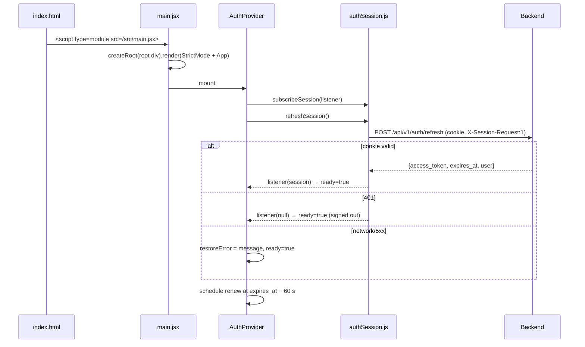
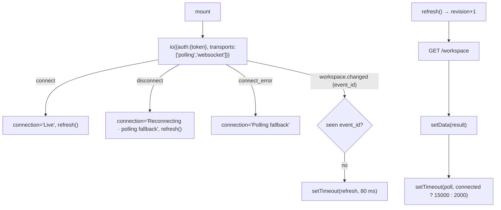
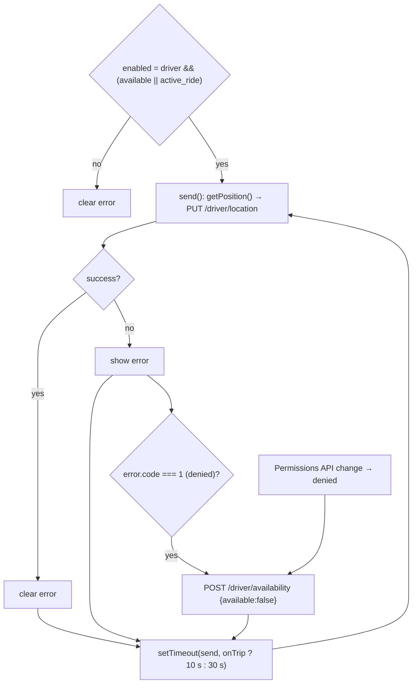

# 04 — Frontend documentation

[← Back to index](README.md) · Next: [05 — Backend documentation →](05-backend-documentation.md)

The frontend lives in `frontend/src/`. It is plain JavaScript + JSX (no TypeScript), React 19 function components, React Router 7, and one global stylesheet. File-level summaries are in [02](02-folder-and-file-structure.md#frontend-frontend); this document explains **how it works**.

## 1. Boot sequence



Until `ready` is true, `AuthPage` and `Protected` render `SessionLoading` ("Restoring your session…"), so the user never briefly sees the login page on reload.

## 2. Routing (`main.jsx::App` and `Workspace`)

Top-level routes:

| Path | Element | Auth |
| --- | --- | --- |
| `/` | `Landing` | public |
| `/test-payment/:token` | `TestPaymentPage` | public (capability token) |
| `/login` | `AuthPage` | redirects to `/{role}` if already signed in |
| `/register` | `AuthPage register` | same |
| `/rider/*`, `/driver/*`, `/admin/*` | `Protected role=…` → `Workspace` | session + matching role |
| `*` | "Wrong turn?" page | public |

`Protected`:

```jsx
if(!ready) return <SessionLoading/>;
if(restoreError && !session) return /* error + Retry + Sign in again */;
if(!session) return <Navigate to="/login" replace/>;
if(session.user.role !== role) return <Navigate to={`/${session.user.role}`} replace/>;
return <Workspace role={role}/>;
```

`Workspace` renders the sidebar from `navItems[role]` and nested routes. The nested route list is computed: `['history','earnings','drivers','rides']` filtered per role (admin: drivers, rides; driver: history, earnings; rider: history), each rendering `RideWorkspace` with a `view` prop. Admin additionally gets `settings` → `FareSettings`, `revenue` → `RevenueSettings`, `audit` → `AdminAudit`. All roles get `account` → `Account`. Unknown sub-paths render `ComingSoon`.

The production server (`backend/app/web.py`) mirrors these prefixes so a hard reload of `/rider/history` returns `index.html`.

## 3. Session handling (`authSession.js`)

This is the most subtle frontend module. Its goals: keep the access token out of persistent storage, never run two refreshes at once (the refresh token is **single-use** — a second concurrent use would look like a replay and revoke the session), and keep multiple tabs consistent.

```js
let session=null, pendingRefresh=null, generation=0, signingOut=false;
const listeners=new Set(), knownTokens=new Set();
const channel=new BroadcastChannel('ridez-auth');            // cross-tab sign-out
const locked=action=>navigator.locks
  ? navigator.locks.request('ridez-refresh-cookie',action)  // cross-tab mutual exclusion
  : action();
```

| Mechanism | Purpose |
| --- | --- |
| `pendingRefresh` | Single-flight within a tab: concurrent callers share one promise |
| `navigator.locks` (`ridez-refresh-cookie`) | Serializes refresh/login/logout **across tabs**, so two tabs never present the same refresh cookie simultaneously |
| `generation` counter | Incremented on sign-in, sign-out and forced sign-out; a refresh that started in an older generation discards its result |
| `knownTokens` | All tokens issued during this session; `resolveToken(token)` maps any of them to the current token and rejects tokens from another session |
| `BroadcastChannel('ridez-auth')` | `signOut` posts `signed-out`; other tabs publish `null` |
| `signingOut` flag | Blocks refreshes during logout |

Every auth request sets `X-Session-Request: 1` and `credentials: 'same-origin'`.

**Refresh triggers:**
1. Boot (`AuthProvider` effect).
2. Timer 60 s before `expires_at` (rescheduled whenever `access_token` changes); failure retries in 15 s.
3. Any API call that returns 401 (`api.js`).
4. `signOut(true)` refreshes first to obtain a guaranteed-valid Bearer token for `logout-all`.

## 4. HTTP client (`api.js`)

```js
export async function api(path, { token, ...options } = {}) {
  const activeToken = resolveToken(token);                       // current token for this session
  const send = t => fetch(`/api/v1${path}`, { ...options, credentials:'same-origin',
      headers: { 'Content-Type':'application/json', ...(t ? {Authorization:`Bearer ${t}`} : {}), ...options.headers } });
  let response = await send(activeToken);
  if (response.status === 401 && activeToken && !options.signal?.aborted) {
    const renewed = currentSession()?.access_token !== activeToken ? currentSession() : await refreshSession();
    if (renewed && resolveToken(token)) response = await send(renewed.access_token);  // retry once
  }
  let data; try { data = await response.json(); } catch { throw new Error('Unable to read the server response. Please retry.'); }
  if (!response.ok) throw new Error(data.error || 'Something went wrong. Please try again.');
  return data;
}
```

Consequences:
- Components pass the token they received as a prop; even if it is 14 minutes old, the request uses the latest token.
- The backend's `{"error": "..."}` message is surfaced verbatim in the UI.
- Supports `AbortController` signals (used by polling hooks to cancel on unmount).

## 5. The workspace: data model and refresh loop

### `useWorkspace(token)`



- The socket effect depends on `token`; every token rotation (≈ every 14 min) reconnects with the new token. This matters because the server disconnects sockets whose JWT `exp` has passed.
- The polling effect depends on `revision`; `refresh()` bumps it, which aborts the in-flight poll and starts a new one immediately.
- `updateAvailability(result)` patches `available`/`resume_available` optimistically after the availability POST, before the next poll.

### `perform(path, body)` — the mutation helper

```js
async function perform(path, body = {}) {
  if (busy) return;                     // one action at a time
  setBusy(true); setActionError('');
  try {
    const response = await api(path, {token, method:'POST', body: JSON.stringify(body)});
    if (typeof response.available === 'boolean' && typeof response.resume_available === 'boolean') updateAvailability(response);
    if (response.ride?.status === 'COMPLETED') setCompleted(response.ride);   // driver "trip completed" notice
    refresh();
    return response;
  } catch (e) { setActionError(e.message); return null; }
  finally { setBusy(false); }
}
```

It is passed down to `BookingPanel`, `RideCard`, `CancelRideControl`, `DriverCollectCard`. All buttons use `disabled = busy || !!error`, so a broken connection pauses all actions.

### What each role sees (`RideWorkspace` render tree)

**Rider – overview**
1. Recent cancellation notice (if `data.recent_cancellation` and not dismissed).
2. If `data.trip_otp` and no driver yet: "Your ride OTP" card.
3. If `active_ride` → `ActiveRidePanel`; else → `BookingPanel` + "Most recent journey" card.
4. `PaymentPrompt` modal when `usePaymentPrompt` selects a ride.

**Driver – overview**
1. Approval/availability banner with **Go available / Go offline** (only for active drivers without an active ride; disabled when bookings are disabled).
2. Suspension reason (from `data.suspension`).
3. `PaymentConfirmedFlash`, then one `DriverCollectCard` per completed ride with pending payment.
4. Own rating badge, location freshness line.
5. If active ride → `ActiveRidePanel` with the **"Stay available after this trip"** checkbox (calls `changeDriverAvailability(checked)`); else "Incoming requests" invitation cards with Countdown, quote and Accept/Reject (disabled when expired).

**Driver – earnings**: two totals (`confirmed_earnings`, `pending_earnings`) and one card per ledger entry with a paid/awaiting badge.

**Admin – overview**: metrics grid (10 tiles), `DriverManagement`, recent rides list. **Admin – drivers**: `DriverManagement`. **Admin – rides**: rides list. Ride cards for admins include settlement and both ratings with comments.

**History** (rider/driver): all rides via `RideCard`.

### `RideCard` decision logic

| Condition | Rendered |
| --- | --- |
| `status === 'CANCELLED'` | `CancellationNotice` |
| Driver assigned and status in ASSIGNED/ARRIVING/WAITING/IN_PROGRESS and viewer is rider/driver | `AssignedRideDetails` + collapsible fare breakdown |
| otherwise | `QuoteDetails` + driver line + rider name (for drivers) |
| `SEARCHING` | `Countdown` to `expires_at`, round number and radius |
| driver & `WAITING` & not cancelling | `OtpInput` |
| driver & next action exists | Primary button; `start` disabled until 6 OTP digits; `complete` asks `window.confirm` |
| rider in SEARCHING/ASSIGNED/ARRIVING/WAITING, or assigned driver in ASSIGNED/ARRIVING/WAITING | `CancelRideControl` (opening it hides the action buttons) |
| driver/admin & `settlement` | "Allocation recorded · not a payment" block |
| always | `PaymentStatusLine` (only renders for completed rides with a payment) |
| COMPLETED & participant & (already rated or completed < 7 days ago) | `RatingForm compact` |
| admin & ratings | Both ratings with comments |
| always | `TestPaymentCard` (self-hides unless relevant) |

### `usePaymentPrompt(role, data)`

```js
const previous = lastActive.current;               // undefined on first render
lastActive.current = data.active_ride?.id || null;
if (previous && !data.active_ride) candidate = data.rides.find(r => r.id === previous);   // active ride just ended
else if (previous === undefined && !data.active_ride) {                                     // first load
  const latest = data.rides[0];
  if (latest?.completed_at && Date.now() - Date.parse(latest.completed_at) < 30*60000) candidate = latest;
}
if (candidate?.status === 'COMPLETED' && candidate.payment?.status === 'PENDING' && !paymentDismissed(candidate.id)) setRideId(candidate.id);
```

"Pay later" stores `ridez.payment-dismissed.{rideId}` in `sessionStorage` (per tab).

## 6. Booking flow components

### `BookingPanel`

- `provider === 'google'` → `AddressSearch` fields + map picker; otherwise free-text labels with coordinates visible.
- Form state keeps coordinates as **strings** (inputs) and converts with `Number()` on submit.
- Editing an address label in Google mode clears its coordinates (`change`), forcing a fresh selection — prevents a label/coordinate mismatch.
- "Use my location" reuses `getPosition()` from `useDriverLocation.js` to set the pickup.
- After a quote: shows `QuoteDetails`, expiry time, `fare_rule_version`, and **Confirm ride** → `perform('/rides', {quote_id})`; on success the quote is cleared and the workspace refresh shows the active ride.

### `AddressSearch` — race-safe autocomplete

Three refs make async results safe:
- `sequence` — incremented on every keystroke/blur/Escape; a suggestions response is applied only if its sequence is still current **and** the input value hasn't changed (`latest.current === query`).
- `selection` — same idea for the place-details fetch after clicking a suggestion.
- `alive` — prevents state updates after unmount.

It creates one `AutocompleteSessionToken` per typing session and clears it after a selection or blur, which is how Google groups autocomplete + details into one billing session **(Google documentation; not verifiable from code)**.

### `GoogleRouteMap`

Two effects: (1) initialize the map once per `attempt` (retry increments it); (2) redraw markers/polyline whenever pickup, destination or polyline changes, then `fitBounds` with 55 px padding. A third effect moves a single driver marker without redrawing everything. Map clicks call `onSelect(mode, {lat, lng})` where `mode` is `pickup` or `destination`.

## 7. Driver GPS (`useDriverLocation.js`)



- Requires `window.isSecureContext` (HTTPS or localhost).
- High-accuracy attempt (15 s) then low-accuracy retry (20 s) — desktop browsers often time out on high accuracy; the server still enforces ≤ 200 m accuracy.
- The effect restarts when `available` or `onTrip` changes, which also changes the interval.
- Background tabs are throttled by browsers; the UI tells drivers to keep the tab open.

## 8. Trip-in-progress UI

`ActiveRidePanel` calls `useTripRoute(ride, token)` once and passes its state to both `TripStatsCard` and `TripRouteMap`, so only one poll runs. The poll key is `ride.id:phase`, so it restarts immediately on phase change (e.g. ARRIVING → WAITING). The server dictates the poll interval via `refresh_after_seconds` (10 s).

`TripStatsCard` only shows live numbers when `data.origin_source === 'driver'` and `data.target` matches the phase (pickup during approach, destination during the trip). Otherwise it shows the booked estimate with an explanatory note. Arrival time = `generated_at + duration_seconds`.

## 9. Payments and ratings UI

- `PaymentPrompt` (rider modal) views: `choose` → `cash` (waiting for driver) or `online` (QR) → `failed` (retry/cash) → confirmed (`PaymentSuccess` + `RatingForm`). It closes on Escape or backdrop click. Choosing ONLINE immediately generates the QR.
- `TestPaymentCard` appears on completed ride cards when test payments are enabled (or a mock record exists) and the ride is not already paid by cash.
- `DriverCollectCard` shows the rider's chosen method and a "Cash received" button for every completed, unpaid ride.
- `usePaymentConfirmedFlash` compares the previous set of pending ride IDs with the new data to detect a confirmation and shows a 6-second success banner.
- `RatingForm` filters tags by sentiment: 4–5 stars show only positive tags, 1–2 only negative (`NEGATIVE` set), 3 shows all; tags reset when the star value changes; max 5 tags. The server is the source of the tag list (`workspace.rating_tags`, via `RatingTags` context).

## 10. Admin pages

All admin pages manage their own `data/error/busy/message` state and talk to the API directly.

| Page | Load | Save | Concurrency handling |
| --- | --- | --- | --- |
| `FareSettings` | `GET /admin/fare-settings` | `PUT` with `version`, `reason`, full `policy` | 409 "Fare settings changed. Reload before saving" → "Reload settings" button |
| `RevenueSettings` | `GET /admin/revenue-share` | `PUT` with `version`, pct strings, `effective_from` ISO or null | Same; client blocks save unless total = 100 |
| `DriverManagement` | `GET /admin/drivers?page&status&q` (refetches on `refreshKey` = `metrics.as_of`) | `POST /admin/drivers/{id}/{action}` with `version: status_revision` | Stale version → error + "Reload drivers" |
| `VehicleEditor` | from driver row | `PUT /admin/drivers/{id}/vehicle` with `version` | Stale → error |
| `AdminAudit` | `GET /admin/audit?page&category&q`; detail on demand | read-only | — |

## 11. Forms and validation

Client-side validation is **convenience only**; the server re-validates everything.

| Form | Client checks | Server checks (authoritative) |
| --- | --- | --- |
| Register | `required`, `maxLength=100`, `minLength=10` password, `type=tel` | name 1–100, password 10–128, E.164 mobile, role |
| Login | required | normalized, generic 401 |
| Booking | coordinates present | 1–160 char labels, coordinate bounds, distinct pickup/destination |
| OTP | 6 digits before enabling Start | 6 ASCII digits + HMAC match + rate limit |
| Cancel | reason chosen; text required for "Other" | 1–300 chars |
| Rating | stars > 0 | stars int 1–5, ≤ 5 known tags, comment ≤ 300 |
| Fare settings | `type=number` min/max, `required` | strict decimals, ranges, zone schema |
| Revenue | total = 100 | 2-dp percentages, sum = 100, date window |
| Vehicle | `required`, `maxLength` | regex for registration, lengths |

## 12. Accessibility notes (observed in code)

- Error messages use `role="alert"`, status lines `role="status"` / `aria-live`.
- `AddressSearch` implements the ARIA combobox pattern (`aria-expanded`, `aria-activedescendant`, listbox/option).
- `OtpInput` uses a `fieldset`/`legend`, per-digit `aria-label`, `inputMode="numeric"`.
- Star rating uses `role="radiogroup"` / `role="radio"`.
- `PaymentPrompt` is `role="dialog" aria-modal="true"`, focuses its first button, closes on Escape (no full focus trap).

## 13. Known frontend limitations

- Workspace header always shows "Development" (hard-coded) even in production.
- No global error boundary; a render exception blanks the page.
- `Account` page: profile editing and account recovery explicitly not implemented.
- No unit tests; the only browser test is not in CI.
- Admin ride list is limited to the 100 most recent rides returned by `/workspace` (no pagination).
