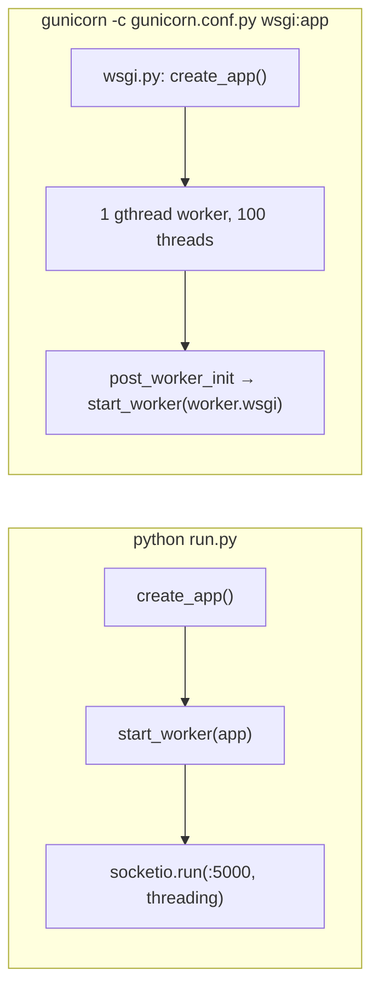

# 05 — Backend documentation

[← Back to index](README.md) · Next: [06 — API documentation →](06-api-documentation.md)

File-level summaries and full function tables are in [02](02-folder-and-file-structure.md#backend-backendapp). This document explains the **logic** of the important backend functions in logical blocks, with code excerpts from the repository.

## 1. Process startup



`flask run` would **not** start the worker; the README explicitly says to use `python run.py`. `create_app` details: [02](02-folder-and-file-structure.md#backendapp__init__py--application-factory).

## 2. Request plumbing (`routes.py`)

```python
def authenticated(role=None):
    def decorate(fn):
        @wraps(fn)
        def wrapped(*args, **kwargs):
            header = request.headers.get('Authorization', '')
            from .session_service import authenticate
            if not header.startswith('Bearer '):
                raise ApiError('Please sign in again', 401)
            g.user, g.auth_claims = authenticate(header[7:])   # JWT + DB session check
            if role and g.user.role != role:
                raise ApiError('You do not have access to this workspace', 403)
            return fn(*args, **kwargs)
        return wrapped
    return decorate
```

Every protected view gets a fresh `User` row in `g.user`, so a status change (e.g. suspension) is visible on the very next request.

## 3. Accounts (`services.py`)

### Permanent account code

```python
digest = base64.b32encode(hmac.new(USER_CODE_SECRET, f'{role}:{mobile}'.encode(), sha256).digest()).decode().rstrip('=')
prefix = {'rider': 'RID', 'driver': 'DRV', 'admin': 'ADM'}[role]
for length in range(12, 33, 4):          # 12, 16, 20, 24, 28, 32 chars
    candidate = f'{prefix}-{digest[:length]}'
    if not users.code_exists(candidate):
        code = candidate; break
```

- Deterministic for a given role + mobile + secret, but **unguessable** without the secret.
- Collision handling lengthens the code instead of failing.
- Changing `USER_CODE_SECRET` would not change existing stored codes, but would change future derivations and **all trip OTPs** (README warns to keep it stable).

### Login timing defence

`login()` always runs `check_password_hash`, against a cached dummy hash when the mobile is unknown, so response time doesn't reveal which mobiles are registered. All failures (bad format, unknown, wrong password, disabled) return the same 401 message.

## 4. Sessions (`session_service.py`)

### `refresh()` — rotation with replay detection

```python
value = request.cookies.get(COOKIE, '')
record = db.session.get(RefreshToken, digest(value)) if value and len(value) <= 128 else None
session = valid_session(record.session_id) if record else None
user = db.session.get(User, session.user_id) if session else None
if not session or not user or user.status == 'disabled':
    if session: revoke(session); db.session.commit()
    raise ApiError('Please sign in again', 401)
changed = db.session.execute(update(RefreshToken)
    .where(RefreshToken.token_hash == record.token_hash, RefreshToken.used_at.is_(None))
    .values(used_at=now())).rowcount
if changed != 1:                       # token already used → stolen or replayed
    revoke(session); db.session.commit()
    raise ApiError('Session credential was already used. Please sign in again', 401)
token = new_refresh(session); db.session.commit()
return payload(user, session), token
```

Block by block:
1. Only the SHA-256 hash is stored, so a DB leak does not leak usable refresh tokens.
2. Session must be un-revoked, unexpired (absolute 30-day lifetime — refreshing does **not** extend `expires_at`), and the user not disabled.
3. The conditional `UPDATE … WHERE used_at IS NULL` makes the token single-use even across threads; a second use revokes the whole session (OAuth-style refresh-token reuse detection).
4. A new refresh token is chained to the same session.

### `authenticate(token)`

Decodes HS256 with required claims `sub, sid, iat, exp`, then checks the user and the **session row** on every request. That makes logout and suspension-of-sessions immediate even though JWTs are normally stateless.

### `stop_requests(user_id)`

Used by logout, refresh-replay revocation and admin status changes. For drivers: lock the user row, set `available=False, resume_available=False`, close PENDING invitations, notify. An active trip is **not** affected.

## 5. Ride service (`ride_service.py`)

### `quote(user, data)`

1. `simulator()` guard.
2. `pickup`, `destination` labels 1–160 chars; `pickup_lat/lng` required numbers; must differ (case-insensitive).
3. Destination coordinates optional (required by Google provider).
4. `expire()` to catch up matching (affects demand surge counts).
5. `route_provider.compute(...)` → distance/duration/polyline.
6. `fare_service.calculate(route, pickup)` → itemized fare dict.
7. Insert `FareQuote` with `expires_at = now + 5 min`, `distance_km = round(distance_m/1000, 2)`, `duration_min = ceil(seconds/60)`.
8. Return `quote.public()` + `polyline` (the polyline is **not stored**).

### `book(user, data)`

```python
quoted = repo.get(FareQuote, quote_id)
if not quoted or quoted.rider_id != user.id: raise ApiError('Quote not found', 404)
existing = repo.ride_for_quote(quote_id)
if existing: return public(existing, user)                 # idempotent retry
if quoted.expires_at <= now(): raise ApiError('Quote expired. Request a new estimate', 409)
if quoted.provider != current_app.config['ROUTE_PROVIDER']: raise ApiError('Route mode changed…', 409)
if quoted.pickup_lat is None: raise ApiError('Get a new quote with pickup coordinates', 409)
if repo.get(ActiveRide, user.id): raise ApiError('You already have an active ride', 409)
ride = repo.add(Ride(..., status='SEARCHING', round_no=1, radius_m=500,
                     requested_at=now(), expires_at=now()+timedelta(seconds=MATCH_ROUND_SECONDS)))
try:
    db.session.flush()
    repo.add(ActiveRide(user_id=user.id, ride_id=ride.id))  # PK user_id: one active ride
    matching.invite(ride, ride.requested_at)
    repo.notify_ride(ride)
    repo.commit()
except IntegrityError:                                      # concurrent double-submit
    repo.rollback()
    existing = repo.ride_for_quote(quote_id)
    if existing: return public(existing, user)
    raise ApiError('You already have an active ride', 409)
```

Two uniqueness constraints carry the correctness: `rides.quote_id` (same quote twice) and `active_rides.user_id` (two different quotes at once).

### `availability(user, data)`

```python
locked = repo.lock_active_driver(user.id) if available else repo.lock_driver(user.id)
if not locked: raise ApiError('Your driver status does not allow new requests', 403)
db.session.refresh(user)
active = db.session.scalar(select(ActiveRide).where(ActiveRide.user_id == user.id))
if available:
    location_service.update(user, data, initializing=not bool(active))
online = available and not bool(active)                 # busy drivers stay unavailable
repo.set_available(user.id, online, resume_available=available)
if not available:
    UPDATE ride_invitations SET status='OFFLINE' WHERE driver_id AND status='PENDING'
repo.notify(user.id); repo.commit()
return dict(available=online, resume_available=available, active_trip=bool(active))
```

- Going online requires an **active** status and a valid GPS fix in the same request.
- While on a trip, the same call only stores the "stay available after this trip" preference (`resume_available`).
- Going offline always works (even when suspended) and withdraws pending invitations.

### `accept(user, ride_id)`

Checks (in order): invitation exists (404) → idempotent if already this driver's ride → driver has no active claim (409) → active and available (403) → fresh location (409) → invitation PENDING, ride SEARCHING, round not expired (409). Then:

```python
if not repo.lock_active_driver(user.id): ... 403
if not repo.assign(ride.id, user.id, now(), repo.get(DriverVehicle, user.id)): ... 409 'Another driver has already accepted this ride'
repo.add(ActiveRide(user_id=user.id, ride_id=ride.id))
repo.close_invitations(ride.id, 'CLOSED'); invitation.status = 'ACCEPTED'
repo.set_available(user.id, False)
matching.close_round(ride, 'ASSIGNED')
repo.notify_ride(ride); repo.commit()                     # IntegrityError → 409
```

`ride_repository.assign` re-validates **everything inside the UPDATE's WHERE clause** so a check-then-act race cannot slip through:

```python
valid_invitation = select(Invitation.ride_id).where(Invitation.driver_id == driver_id,
    Invitation.status == 'PENDING', Invitation.expires_at > now)
eligible = select(DriverPresence.driver_id).join(User…).join(DriverLocation…).where(
    DriverPresence.driver_id == driver_id, DriverPresence.available.is_(True), User.status == 'active',
    DriverLocation.fresh.is_(True), DriverLocation.recorded_at > cutoff, DriverLocation.updated_at > cutoff).exists()
update(Ride).where(Ride.id == ride_id, Ride.status == 'SEARCHING', Ride.expires_at > now,
                   Ride.id.in_(valid_invitation), eligible)
            .values(status='ASSIGNED', driver_id=driver_id, vehicle_registration=…, vehicle_model=…, vehicle_color=…)
```

### `move(user, ride_id, action, data)`

**Cancel branch**

| Step | Rule |
| --- | --- |
| Authorization | rider of this ride, or the assigned driver (admins cannot cancel) |
| Idempotency | already CANCELLED → return current record |
| State | only SEARCHING, ASSIGNED, ARRIVING, WAITING |
| Reason | required (1–300) except SEARCHING without a `reason` key → `"Rider cancelled the search"` (legacy clients) |
| Write | `transition(old → CANCELLED, cancelled_at, cancelled_by, cancellation_reason)` |
| Side effects | close invitations, driver offline with `resume_available=False`, release both claims, close round if searching |

**Driver transitions**

```python
transitions = {'depart': ('ASSIGNED','ARRIVING'), 'arrive': ('ARRIVING','WAITING'),
               'start': ('WAITING','IN_PROGRESS'), 'complete': ('IN_PROGRESS','COMPLETED')}
old, new = transitions[action]
if action == 'start' and ride.status in (old, new): verify_trip_otp(ride, user.id, data.get('otp'))
if ride.status == new: return public(ride, user)          # idempotent retry
if ride.status != old: raise ApiError(f'Cannot {action} a trip in {ride.status.lower()} state', 409)
```

Note: the OTP is checked even on a `start` retry (status already `IN_PROGRESS`), so a retry must resend the code.

**Completion side effects**

```python
repo.lock_driver(user.id); db.session.refresh(user)        # serialize with suspend/offline
transition(IN_PROGRESS → COMPLETED, completed_at)
revenue_service.allocate(ride, quoted, user.id, completed_at)
payment_service.record_completion(ride, quoted, completed_at)
repo.release(ride.id)
eligible = (user.status == 'active' and presence.resume_available
            and location_service.is_fresh(driver_location, completed_at)
            and (ROUTE_PROVIDER == 'google' or SIMULATOR_ENABLED))
repo.set_available(user.id, eligible)
```

All in one transaction with the outbox events, then commit.

### `snapshot(user)` — the `/workspace` payload

Common keys: `rides` (≤ 100, role-filtered, each via `public()`), `active_ride`, `simulator`, `route_provider`, `booking_enabled`, `user`.

| Role | Extra keys |
| --- | --- |
| rider, driver | `recent_cancellation` (latest ride cancelled within 10 min and no active ride), `my_rating_summary`, `rating_tags` |
| rider | `trip_otp` while the active ride is SEARCHING/ASSIGNED/ARRIVING/WAITING |
| driver | `location` (freshness only), `suspension` (reason from matching audit row), `resume_available`, `available`, `invitations` (only if active, available, fresh and not busy), `earnings` (ledger + payment), `allocated_earnings`, `confirmed_earnings`, `pending_earnings` |
| admin | `metrics`, `drivers` (≤ 100 with location freshness) |

## 6. Matching (`matching.py`)

### `invite(ride, started_at)`

```python
repo.add(MatchRound(ride_id=ride.id, round_no=ride.round_no, radius_m=ride.radius_m,
                    started_at=started_at, expires_at=ride.expires_at, outcome='SEARCHING'))
if ride.expires_at <= utcnow() or quoted.pickup_lat is None: return       # catch-up: don't invite into a dead round
previous = set(driver_ids already invited for this ride)
for presence in repo.eligible_drivers(utcnow()):
    location = repo.get(DriverLocation, presence.driver_id)
    if presence.driver_id not in previous and distance_m(pickup, location) <= ride.radius_m:
        if not repo.lock_active_driver(presence.driver_id, require_available=True): continue
        repo.add(Invitation(ride_id=ride.id, driver_id=presence.driver_id, status='PENDING',
                            round_no=ride.round_no, expires_at=ride.expires_at))
```

Eligibility is evaluated in Python with haversine over **all** eligible drivers (no spatial index). Each round invites only drivers newly in range.

### `advance()`

```python
at = utcnow()
for _ in range(MATCH_MAX_RADIUS_M // 500 + 1):            # bounded catch-up (11 passes at 5 km)
    due = repo.expired_searches(at)
    if not due: break
    for ride in due:
        old_no, deadline = ride.round_no, ride.expires_at
        if not repo.expire_round(ride, at): repo.rollback(); continue   # someone else claimed it
        db.session.refresh(ride)
        old_round.outcome = 'EXPIRED'; repo.close_invitations(ride.id)  # PENDING → EXPIRED
        if ride.radius_m >= MATCH_MAX_RADIUS_M or quote has no pickup:
            ride.round_no = old_no; ride.status = 'NO_DRIVER_FOUND'; repo.release(ride.id)
        else:
            ride.round_no = old_no + 1; ride.radius_m += 500
            ride.expires_at = deadline + timedelta(seconds=MATCH_ROUND_SECONDS)   # schedule from old deadline, not "now"
            invite(ride, deadline)
        repo.notify_ride(ride); repo.commit()
    db.session.expire_all()
# stale GPS sweep
for location in fresh locations with recorded_at or updated_at ≤ at − 90 s:
    location.fresh = False; repo.notify(location.driver_id)
```

Why the new deadline is `deadline + 30 s` rather than `now + 30 s`: after downtime the loop replays missed rounds on the original schedule; rounds whose deadline already passed are recorded but send no invitations (`invite` returns early), and the loop continues until it reaches a round that is still open or the maximum radius.

With defaults, a search lasts at most 10 rounds × 30 s = 5 minutes (radius 500 → 5000 m).

## 7. Locations (`location_service.update`)

```python
if user.status != 'active' and not (user.status == 'suspended' and active and not initializing):
    raise 403 'Driver approval is required'          # suspended drivers may keep tracking an active trip
if not initializing and not presence.available and not active:
    raise 409 'Location updates are only allowed while available or on a trip'
lat, lng = coordinate(...); accuracy = coordinate(accuracy_m, 'Accuracy', 200)   # ≤ 200 m
captured = parse ISO with timezone → UTC
if captured > now + 15 s or captured <= now − 90 s: raise 'Location time is stale or in the future'
if location exists:
    if captured < location.recorded_at: raise 409 'older than the latest accepted update'
    if is_fresh(location):                                     # only when continuously tracked
        movement = distance_m(old, new)
        seconds = captured − old.recorded_at
        if movement > seconds × 55.56 m/s (200 km/h) + old.accuracy + new.accuracy + 100:
            raise 409 'Location movement is implausible'
    if captured == location.recorded_at: return public(location)   # replay: do not bump updated_at
else: create
set lat/lng/accuracy, recorded_at=captured, updated_at=now, fresh=True; notify(driver)
```

Freshness uses **two clocks**: `recorded_at` (device time) and `updated_at` (server receipt). Both must be within 90 s.

## 8. Routing (`route_provider.compute`)

**Simulator**

```python
seed = int(sha256('|'.join(label.casefold() for label in labels)).hexdigest()[:8], 16)
distance = (200 + seed % 1800) * 10              # 2 000 … 19 990 m
duration_seconds = max(5, int(distance_km * 3)) * 60   # 3 min per km, ≥ 5 min
```

Deterministic per label pair, so repeated quotes are stable. Example: "City centre" → "Riverside" = 17 340 m, 3 120 s (52 min).

**Google**

```python
requests.post('https://routes.googleapis.com/directions/v2:computeRoutes',
  json={'origin': waypoint(pickup), 'destination': waypoint(destination), 'travelMode': 'DRIVE',
        'routingPreference': 'TRAFFIC_AWARE', 'computeAlternativeRoutes': False, 'polylineQuality': 'OVERVIEW'},
  headers={'X-Goog-Api-Key': key,
           'X-Goog-FieldMask': 'routes.distanceMeters,routes.duration,routes.staticDuration,routes.polyline.encodedPolyline'},
  timeout=(3, 10), allow_redirects=False)
```

`duration` (traffic-aware) is the billed/displayed duration; `staticDuration` (no traffic) is stored as `baseline_seconds` and used for the traffic-surge ratio. Error mapping: see [11 — Integrations](11-third-party-integrations.md#google-routes-api-server-side).

## 9. Fares (`fare_service.calculate`)

```python
base = policy.base
distance_fare = money(distance_m / 1000 × per_km)
time_fare     = money(duration_seconds / 60 × per_minute)        # prorated per second
components = base + distance_fare + time_fare
subtotal = max(components, minimum)                               # minimum_adjustment = subtotal − components
multipliers = [(1, 'No surge')]
traffic_ratio = duration / baseline  (if baseline available)
if surge_enabled:
    for zone in zones: if enabled and scheduled(zone, local_time) and haversine(pickup, centre) ≤ radius:
        multipliers.append((zone.multiplier, 'Zone: ' + name))
    if traffic_enabled and traffic_ratio ≥ traffic_threshold: append((traffic_multiplier, 'Traffic threshold'))
    if demand_enabled:
        requests, ratio = demand_signal(pickup, at)              # within 1 km
        if requests ≥ demand_min_requests and ratio ≥ demand_threshold: append((demand_multiplier, 'High demand within 1 km'))
highest = max(multipliers); multiplier = min(highest, max_multiplier)
reason = '; '.join(reasons with value == highest and > 1) or 'No surge'; add ' (capped)' if capped
total = money(subtotal × multiplier)
```

Multipliers are **not** compounded — only the single highest applies. Worked example with defaults (simulator, City centre → Riverside):

| Component | Value |
| --- | --- |
| base | ₹40.00 |
| distance 17.34 km × ₹12 | ₹208.08 |
| time 52 min × ₹2 | ₹104.00 |
| total (no surge, above minimum) | **₹352.08** |
| driver allocation 85 % | ₹299.27 |
| company allocation | ₹52.81 |

`scheduled(zone, local)`: if `start == end` the zone is active all day on selected days; if `start < end` it's a same-day window; otherwise it's an overnight window that **belongs to its start day** (e.g. Fri 22:00–02:00 is active Fri 22:00–24:00 and Sat 00:00–02:00).

## 10. Revenue (`revenue_service`)

- `active(at)` picks the latest setting with `effective_from ≤ at`; ties go to the highest version.
- `allocate` rounds the driver share half-up and gives the company the **remainder**, so `driver + company == total` exactly.
- `save` stores `previous_driver_pct/previous_company_pct` = split active at save time, for audit display.

## 11. Payments (`payment_service`) and mock QR

- `record_completion` creates `ride_payments` PENDING at completion with `amount = quote.total`.
- `choose` only changes `method` while PENDING (conditional update). Choosing the same method again is a no-op.
- `confirm` is the single conditional write that finalizes payment. Both the driver's cash confirmation and the mock QR success call it; whichever commits first wins.
- Mock QR tokens are `itsdangerous` signatures of the ride ID with salt `mock-qr-payment-v1` and `max_age=900`. They are bearer capabilities (no login).

## 12. Ratings (`rating_service.submit`)

Participants only (404), COMPLETED only (409), `stars` int 1–5 (bool rejected), ≤ 5 tags from `TAGS[role]`, comment ≤ 300 (trimmed, empty → null). Tags stored `|`-joined with duplicates removed. Insert; on `IntegrityError`, same stars → return existing (idempotent), different → 409 "You have already rated this trip". There is **no server-side time window** for rating; the 7-day window is UI-only.

`summary(user_id)` = `AVG(stars)` formatted to 1 decimal and `COUNT(*)` over ratings received.

## 13. Admin (`admin_service`)

### `change_driver_status`

```python
old, new, event = DRIVER_TRANSITIONS[action]
legacy = action == 'approve' and version is None         # old UI sent no version
if legacy: if driver.status == new: return driver.public(); version = driver.status_revision
if driver.status == new and driver.status_revision == version + 1:
    if matching audit row (same admin, reason, revision, event): return driver.public()   # exact retry
if driver.status_revision != version: 409 'Driver status changed…'
if driver.status != old: 409 f'Cannot {action} a {driver.status} driver'
UPDATE users SET status=new, status_revision=version+1
  WHERE id AND role='driver' AND status=old AND status_revision=version     # rowcount must be 1
stop_requests(driver_id)
INSERT admin_audit(before_status=old, after_status=new, status_revision=version+1, reason)
```

### `audit(params)` and `audit_detail`

`events()` builds one `UNION ALL` of three tables into a common shape, joined to `users` for `actor_name`. Search uses `ILIKE` with `\`, `%`, `_` escaped so user input is literal. Details produce friendly before/after rows; fare policy diffs compare version N with N−1 (or `DEFAULT_POLICY` for version 1) and list only changed keys.

### `metrics()`

Counts rides by status with one `GROUP BY`; "available" drivers = available + active + not on a trip; "fresh" additionally requires a fresh location; stale = available − fresh; allocation sums over the whole ledger.

## 14. Trip map (`trip_map_service`)

```python
phase  = 'in_progress' if IN_PROGRESS else 'approach' if ASSIGNED/ARRIVING else 'overview'
driver = fresh driver position or None
source = 'driver' if phase in ('in_progress','approach') and driver else 'pickup'
origin = driver if source == 'driver' else pickup
target = pickup if (phase == 'approach' and source == 'driver') else destination
value  = cached_route((ride.id, phase, source, towards, at_destination), compute)
db.session.expire_all(); ride = accessible(...)                  # re-check after the slow Google call
if ride no longer active or phase changed: 409; if source changed: 409
return {..., driver_position, origin_source, target, polyline, distance_m, duration_seconds,
        refresh_after_seconds: 10, generated_at}
```

`cached_route` keeps a dict of `{key: {'future': Future, 'expires': t}}` under a `threading.Lock`. The first caller for a key computes; concurrent callers wait on the same `Future` (≤ 15 s). Results live 60 s (errors 10 s), capacity 256 entries. Because the cache key does **not** include the driver's coordinates, the polyline from the driver's position is refreshed at most once a minute while the `driver_position` marker is updated on every call.

## 15. Real-time (`realtime.py`)

- `connect(auth)`: requires `auth = {token: <JWT>}`; uses the same `authenticate()` as HTTP; returns `False` (reject) on failure. Records `(user_id, exp, sid)` per socket id and joins `user:{id}`; admins also join `admins`.
- There are no client→server events other than connect/disconnect. Server→client event: `workspace.changed {event_id, server_time}`.
- `dispatch()` runs in the worker thread; see [13](13-background-and-realtime-processes.md).

## 16. CLI commands

| Command (from `backend/`) | Effect |
| --- | --- |
| `flask --app run db upgrade` | Apply migrations (production uses `--app wsgi`) |
| `flask --app run init-db` | `create_all()` (development only) |
| `flask --app run create-admin` | Interactive admin creation |
| `flask --app wsgi bootstrap-admin` | Env-driven admin creation |
| `flask --app run check-routing [--probe]` | Routing diagnostics without printing the key |
