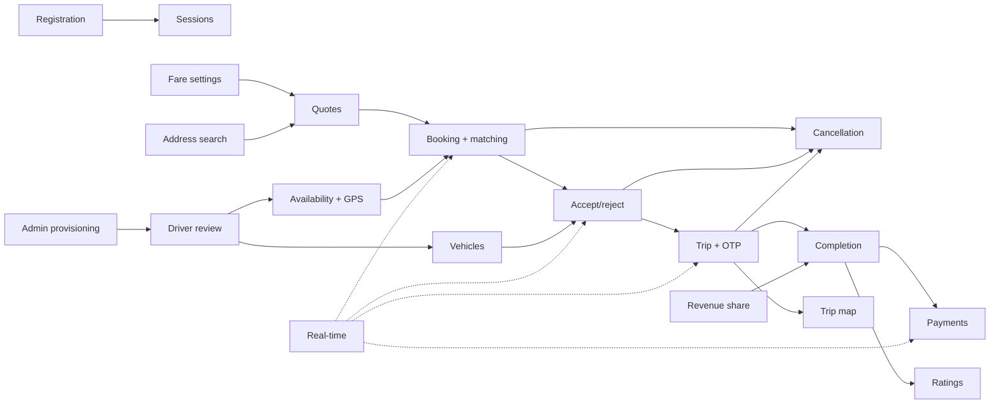

# 09 — Feature-by-feature explanation

[← Back to index](README.md) · Next: [10 — Complete data flow →](10-complete-data-flow.md)

Each feature lists: what/why, user interaction, frontend, backend, APIs, DB, external services, execution flow, important files, errors, edge cases and dependencies. Sequence diagrams are linked rather than repeated.

---

## F1. Registration and permanent account codes

| | |
| --- | --- |
| **What** | Creates a rider or (pending) driver account identified by mobile number; issues a permanent code like `RID-K3J…` |
| **Why** | One account per real phone number; a human-friendly identifier for support and admin search that never changes |
| **User interaction** | `/register` (or `/register?role=driver`), pick "I want to ride/drive", enter name, mobile with country code, password ≥ 10 |
| **Frontend** | `main.jsx::AuthPage.submit` → `api('/auth/register')` → success card shows `user_code` and "pending approval" note for drivers |
| **Backend** | `routes.registration` → `services.register` → `repositories.save` |
| **API** | `POST /api/v1/auth/register` |
| **DB** | `users` INSERT |
| **Flow** | validate → normalize E.164 → duplicate check → HMAC code with collision lengthening → hash password → insert → 201 |
| **Errors** | 400 validation; 409 duplicate; 429 rate limit |
| **Edge cases** | `+91 98765 43210` and `+919876543210` are the same account; concurrent duplicate registration → IntegrityError → 409; admins cannot self-register (`Choose rider or driver`) |
| **Depends on** | `USER_CODE_SECRET` |

Sequence: [diagrams/sequences-auth.md#registration](diagrams/sequences-auth.md#registration).

## F2. Login, session restore, refresh and logout

| | |
| --- | --- |
| **What** | Password login producing a 15-min access token and a 30-day rotating refresh cookie; silent restore on reload; logout (this device / all devices) |
| **Why** | Keep tokens out of JS-readable storage while letting users stay signed in; allow immediate revocation |
| **Interaction** | `/login`; reloading any page restores the session; sidebar "Sign out"; Account → "Sign out all devices" |
| **Frontend** | `authSession.js` (signIn, refreshSession, signOut, locks, broadcast), `main.jsx::AuthProvider` (boot restore + timer), `api.js` (401 → refresh → retry) |
| **Backend** | `routes.sign_in/refresh_session/logout_session/logout_all_sessions`, `services.login`, `session_service.*`, `realtime.disconnect_invalid` |
| **APIs** | `POST /auth/login`, `/auth/refresh`, `/auth/logout`, `/auth/logout-all` |
| **DB** | `auth_sessions`, `refresh_tokens`, `users`, `driver_presence`, `ride_invitations`, `outbox_events` |
| **Errors** | 401 generic credential error; 401 on refresh failure/replay clears cookie; 403 origin/header failures |
| **Edge cases** | Two tabs refreshing simultaneously are serialized by Web Locks; a reused refresh token revokes the session; a driver logging out stops receiving invitations but keeps an active trip; logout without cookie falls back to the Bearer `sid` |
| **Depends on** | F1; `JWT_SECRET`; HTTPS in production (`Secure` cookie) |

Details: [08](08-authentication-and-security.md). Sequences: [diagrams/sequences-auth.md](diagrams/sequences-auth.md).

## F3. Admin provisioning (CLI and bootstrap)

| | |
| --- | --- |
| **What** | Creates admin accounts without any public API |
| **How** | `flask --app run create-admin` (interactive, hidden password) or `BOOTSTRAP_ADMIN=1` + `BOOTSTRAP_ADMIN_MOBILE/PASSWORD[/NAME]` at container start (`deploy/start.sh` → `flask --app wsgi bootstrap-admin`) |
| **Files** | `app/__init__.py` (CLI), `app/bootstrap.py`, `deploy/start.sh`, `deploy/render-start.sh` |
| **Edge cases** | Bootstrap never promotes an existing rider/driver, never reactivates a non-active admin, never resets a password, and is idempotent across restarts; bootstrap env vars are `unset` before Gunicorn starts (verified by `deploy/smoke.py`) |

## F4. Driver approval, suspension and reinstatement

| | |
| --- | --- |
| **What** | Admin review workflow: pending → active (approve), active → suspended (suspend), suspended → active (reinstate), each with a mandatory reason |
| **Why** | Drivers must be vetted; operations need to pause a driver without destroying their trip or earnings |
| **Interaction** | Admin → Drivers (or Overview) → filter/search → "Approve/Suspend/Reinstate driver" → reason → confirm |
| **Frontend** | `DriverManagement.jsx` (`choose`, `save`) sends `{version: status_revision, reason}`; driver sees suspension banner + reason in `RideWorkspace` |
| **Backend** | `admin_service.change_driver_status`, `session_service.stop_requests`; approve also routed via `ride_service.approve` |
| **APIs** | `POST /admin/drivers/{id}/approve`, `/suspend`, `/reinstate`; `GET /admin/drivers` |
| **DB** | `users` (status, status_revision), `admin_audit` INSERT, `driver_presence`, `ride_invitations`, `outbox_events` |
| **Flow** | validate → idempotent retry detection → version and status check → conditional UPDATE → stop requests (offline, close invitations) → audit row → commit |
| **Errors** | 404 not a driver; 400 reason/version; 409 stale version or wrong status |
| **Edge cases** | Suspended driver keeps sign-in, active trip, GPS tracking for that trip, OTP start and completion, and earnings; after completion they are not auto-available. Reinstated drivers stay offline until they go available with fresh GPS. Two admins acting on the same version → one wins, the other gets 409. `disabled` drivers have no actions |
| **Depends on** | F2 (stop_requests), F6 (availability) |

## F5. Vehicle details and ride snapshots

| | |
| --- | --- |
| **What** | Admin records the reviewed car (registration, model, colour); each accepted ride copies these onto the `rides` row |
| **Why** | Riders must verify the car before boarding; later edits must not rewrite trip history/receipts |
| **Frontend** | `DriverManagement` "Vehicle details" (disabled while the driver has an active ride) → `VehicleEditor`; riders see it in `AssignedRideDetails` |
| **Backend** | `admin_service.save_driver_vehicle`; snapshot in `ride_repository.assign` |
| **API** | `PUT /admin/drivers/{id}/vehicle` |
| **DB** | `driver_vehicles` upsert (version+1), `admin_audit` (`driver.vehicle.updated`, details JSON), `rides.vehicle_*` at acceptance |
| **Edge cases** | Edit during an active trip → 409; stale version → 409; registration normalized to upper case with single spaces; drivers without a vehicle are still matchable and the UI shows "Car number not provided" |

## F6. Driver availability and GPS tracking

| | |
| --- | --- |
| **What** | Approved drivers go online with a fresh GPS fix and keep sending location; stale drivers drop out of matching automatically |
| **Why** | Matching must only offer rides to drivers who are actually nearby right now |
| **Interaction** | Driver overview → "Go available" (browser asks for location permission) → keep tab open; "Go offline"; during a trip, "Stay available after this trip" checkbox |
| **Frontend** | `RideWorkspace.changeDriverAvailability` (gets a fix first), `useDriverLocation` (30 s idle / 10 s on trip; permission revoked → go offline) |
| **Backend** | `ride_service.availability`, `location_service.update`, `matching.advance` (stale sweep), `ride_repository.lock_active_driver` |
| **APIs** | `POST /driver/availability`, `PUT /driver/location` |
| **DB** | `driver_presence`, `driver_locations`, `ride_invitations` (→ OFFLINE), `users` lock, `outbox_events` |
| **Validation** | accuracy ≤ 200 m; recorded_at within (now−90 s, now+15 s]; not older than last accepted; movement ≤ 200 km/h + accuracies + 100 m while tracking is fresh; replay of same timestamp is a no-op |
| **Errors** | 403 not active; 409 not available and not on trip; 409 older/implausible; 400 validation; 503 simulator disabled when going online |
| **Edge cases** | Location older than 90 s → `fresh=False` within ≤ 1 s by the worker → excluded from matching and acceptance; a driver re-appearing after a gap is accepted anywhere (no jump check when not fresh); browsers throttle background tabs |
| **Depends on** | F4 (status active), browser geolocation (HTTPS/localhost) |

Sequence: [diagrams/sequences-rides.md#driver-goes-available-and-streams-gps](diagrams/sequences-rides.md#driver-goes-available-and-streams-gps).

## F7. Address search and map selection

| | |
| --- | --- |
| **What** | Google Places (New) autocomplete for pickup/destination, map click selection, "Use my location", manual coordinates |
| **Why** | Google-mode quotes need exact coordinates for both ends |
| **Frontend** | `AddressSearch.jsx`, `GoogleRouteMap.jsx` (picker mode), `BookingPanel.jsx`, `googleMaps.js`, `useDriverLocation.getPosition` |
| **Backend** | none (browser → Google directly) |
| **External** | Maps JavaScript API, Places API (New) with browser key `VITE_GOOGLE_MAPS_BROWSER_KEY` |
| **Edge cases** | < 3 characters → no search; stale responses ignored via sequence counters; editing a selected address clears its coordinates and quote; Google errors show "Address search unavailable…" and the map still allows clicking; in simulator mode only free-text labels + pickup coordinates are needed |

## F8. Fare quotes and surge pricing

| | |
| --- | --- |
| **What** | Server computes route distance/duration and an itemized INR fare; the quote is locked for 5 minutes |
| **Why** | Upfront, auditable pricing that later rate changes cannot alter |
| **Interaction** | Booking form → "Get fare estimate" → "Your fare, upfront" card with breakdown, expiry time, rate version |
| **Frontend** | `BookingPanel.submit` → `perform('/fares/quotes')` → `QuoteDetails`; map draws the returned polyline |
| **Backend** | `ride_routes.quote` (rate limit) → `ride_service.quote` → `route_provider.compute` → `fare_service.calculate` (+ `demand_signal`, `scheduled`) |
| **API** | `POST /fares/quotes` |
| **DB** | read `fare_policies`; demand reads `rides`/`fare_quotes`/`driver_presence`/`driver_locations`; INSERT `fare_quotes` |
| **External** | Google Routes (`computeRoutes`) in Google mode |
| **Pricing** | `subtotal = max(base + km×per_km + min×per_minute, minimum)`; `total = subtotal × min(highest eligible multiplier, max_multiplier)`; sources: zone (circle around pickup on scheduled days/times in policy timezone), traffic (duration/static ≥ threshold), demand (open requests within 1 km ÷ fresh drivers within 1 km ≥ threshold with min requests) |
| **Errors** | Google: 502 denied/invalid/failed, 503 quota/key missing, 504 timeout, 422 no route; **no fallback to simulated data** |
| **Edge cases** | Missing `staticDuration` → no traffic surge and `traffic_available:false`; overnight zone windows belong to their start day; total > 99 999 999.99 → 422; 10 quotes/min/rider |
| **Depends on** | F17 (fare settings) |

## F9. Booking and expanding-radius matching

| | |
| --- | --- |
| **What** | Turning a quote into a SEARCHING ride and inviting nearby drivers in rounds: 500 m, then +500 m every 30 s up to `MATCH_MAX_RADIUS_M` (5 km) |
| **Why** | Offer the ride to the closest drivers first, widening only when needed, and never spam the same driver twice |
| **Interaction** | "Confirm ride" → rider sees "Finding your driver", countdown, round and radius; rider OTP card appears |
| **Frontend** | `BookingPanel` → `perform('/rides')`; `RideCard` SEARCHING view with `Countdown` |
| **Backend** | `ride_service.book`, `matching.invite`, `matching.advance` (worker + per-request), `ride_repository.eligible_drivers/expire_round` |
| **API** | `POST /rides` |
| **DB** | `rides`, `active_rides`, `ride_match_rounds`, `ride_invitations`, `users` (lock), `outbox_events` |
| **Errors** | 404 quote; 409 expired quote, provider changed, missing pickup coords, already active ride |
| **Edge cases** | Double-click / retry → same ride (quote id unique); rider can't hold two active rides; after the server was down, overdue rounds are replayed on the original schedule without sending invitations for expired rounds; final timeout → NO_DRIVER_FOUND and rider claim released |
| **Depends on** | F6, F8, F14 |

Sequences: [booking](diagrams/sequences-rides.md#booking-and-matching-round-1), [round expiry](diagrams/sequences-rides.md#round-expiry-background-worker-or-any-request).

## F10. Accepting / rejecting invitations

| | |
| --- | --- |
| **What** | Driver accepts (first valid acceptance wins) or rejects an invitation |
| **Interaction** | Driver overview → "Incoming requests" card (rider name + rating, countdown, fare) → Accept/Reject |
| **Frontend** | `RideWorkspace` invitation cards → `perform('/rides/{id}/accept')` / `perform('/rides/{id}/reject')` |
| **Backend** | `ride_service.accept` / `reject`, `ride_repository.assign`, `matching.close_round` |
| **DB** | `rides` (ASSIGNED + driver + vehicle snapshot), `active_rides` (driver), `ride_invitations` (ACCEPTED/CLOSED/REJECTED), `driver_presence.available=false`, `ride_match_rounds.outcome` |
| **Errors** | 409 lost race / expired / stale location / already on trip; 403 not active/available |
| **Edge cases** | Two drivers accept simultaneously → exactly one 200 (tested); one driver accepting two rides simultaneously → `active_rides` PK ensures only one; retrying accept after winning returns the ride |

## F11. Trip lifecycle with per-ride OTP

| | |
| --- | --- |
| **What** | Driver-driven state machine ASSIGNED → ARRIVING → WAITING → IN_PROGRESS → COMPLETED; start requires the rider's OTP |
| **Why** | Clear progress for both sides; OTP proves the right passenger is in the car |
| **Interaction** | Driver buttons "Head to pickup", "I've arrived", enter 6-digit OTP + "Start trip", "Complete trip" (confirm dialog). Rider sees progress text, car details, OTP |
| **Frontend** | `RideCard` (`actions` map), `OtpInput`, `AssignedRideDetails`, `TripStatsCard` |
| **Backend** | `ride_service.move`, `services.trip_otp/verify_trip_otp`, `ride_repository.transition` |
| **API** | `POST /rides/{id}/depart`, `/arrive`, `/start`, `/complete` |
| **Errors** | 403 not the assigned driver; 409 wrong state / changed; 400 wrong OTP; 429 too many OTP failures |
| **Edge cases** | Retry of an applied transition returns current state; OTP required on start retries; a code from a previous ride never works; suspended drivers can still progress their current trip |

## F12. Pre-trip cancellation

| | |
| --- | --- |
| **What** | Rider (SEARCHING..WAITING) or assigned driver (ASSIGNED..WAITING) cancels with a reason |
| **Interaction** | "Cancel request"/"Cancel ride" → preset reasons (rider: plans changed, pickup changed, wait too long, details don't match; driver: vehicle problem, can't reach pickup, rider not at pickup; or Other) + notes → confirm |
| **Frontend** | `CancelRideControl`, `CancellationNotice` (in ride card and as a 10-min "recent cancellation" banner) |
| **Backend** | `ride_service.move(action='cancel')`, `ride_service.cancellation` |
| **DB** | `rides` (CANCELLED + who/when/why), `ride_invitations` (CLOSED), `driver_presence` (driver offline, resume false), `active_rides` DELETE, `ride_match_rounds.outcome` |
| **Edge cases** | IN_PROGRESS cannot be cancelled (409); repeated cancel returns the original record; legacy clients may cancel a search without a reason; cancellation vs acceptance/expiry races resolve to exactly one outcome (tested); no fees/refunds |

## F13. Completion, revenue allocation and driver auto-availability

| | |
| --- | --- |
| **What** | On completion the system records the driver/company split once, opens a pending payment, releases claims, and decides whether the driver is immediately available again |
| **Backend** | `ride_service.move('complete')`, `revenue_service.allocate/active`, `payment_service.record_completion` |
| **DB** | `rides`, `revenue_ledger`, `ride_payments`, `active_rides`, `driver_presence` |
| **Rules** | Split = setting effective at server completion time (default 85/15); driver amount rounded half-up, company gets the remainder; auto-available only if driver active + chose "stay available" + location fresh at completion + bookings enabled |
| **Edge cases** | Completion retry never re-enables availability; offline choice during the trip is respected; a split edited later never changes recorded allocations |

## F14. Real-time updates

| | |
| --- | --- |
| **What** | Near-instant UI updates for all parties via Socket.IO invalidation events, with polling fallback |
| **Frontend** | `useWorkspace` (socket + polling), connection badge "Live" / "Polling fallback" |
| **Backend** | `ride_repository.notify/notify_ride` (outbox), `realtime.dispatch`, `realtime.init_realtime` |
| **DB** | `outbox_events` |
| **Edge cases** | Events are at-least-once and carry no data (clients always refetch), so lost/duplicate events are harmless; expired/revoked sockets are disconnected each second |

Details: [13](13-background-and-realtime-processes.md).

## F15. Live trip map and ETA card

| | |
| --- | --- |
| **What** | For Google-mode rides, an embedded road route: driver → pickup while approaching, pickup → destination while waiting, driver → destination during the trip; ETA/distance card; "Navigate in Google Maps" link for drivers |
| **Frontend** | `ActiveRidePanel`, `useTripRoute`, `TripRouteMap`, `TripStatsCard`, `GoogleRouteMap` |
| **Backend** | `trip_map_service.trip_map`, `cached_route`, `route_provider.compute` |
| **API** | `GET /rides/{id}/map` (polled every 10 s) |
| **Edge cases** | Stale/missing driver GPS → pickup-origin route and no driver marker; driver exactly at target → no Google call; ride completes during the Google call → 409, no coordinates leaked; admins excluded; simulator rides get 409 and the map is hidden; Google cost bounded to ≤ 1 call/min per ride/phase/source |

## F16. Payments: cash, online (mock QR)

| | |
| --- | --- |
| **What** | After completion the rider chooses cash or online; the driver confirms cash; online is a **simulated** QR flow; earnings count as "received" only when confirmed |
| **Interaction** | Rider modal "You've arrived!" → Pay online / Pay by cash / Pay later; driver "Collect payment" card → "Cash received"; QR opened on a phone → choose success/failed/pending |
| **Frontend** | `TestPayment.jsx` (`PaymentPrompt`, `TestPaymentCard`, `TestPaymentPage`), `PaymentStatus.jsx` (`DriverCollectCard`, flash), `RideWorkspace.usePaymentPrompt` |
| **Backend** | `payment_service.*`, `test_payment_routes.*` |
| **APIs** | `POST /rides/{id}/payment-method`, `/confirm-cash`, `/test-payment`; `GET/POST /test-payments/{token}` |
| **DB** | `ride_payments`, `mock_payments`, `outbox_events` |
| **Edge cases** | First confirmation wins (cash vs online race); mock SUCCESS is sticky; cash-confirmed rides refuse later test QR; online choice blocked if test payments are disabled; QR links expire after 15 min; prompt re-opens on reload within 30 min of completion unless dismissed in that tab |
| **Not implemented** | Real payment gateway, receipts, refunds, tips, taxes |

## F17. Admin fare settings

| | |
| --- | --- |
| **What** | Versioned fare policy editor (rates, minimum, timezone, global surge switch and cap, traffic/demand surge, up to 20 scheduled circular zones) with reason and history |
| **Frontend** | `FareSettings.jsx` |
| **Backend** | `fare_service.settings/save/validate` |
| **APIs** | `GET`/`PUT /admin/fare-settings` |
| **DB** | `fare_policies` (append-only) |
| **Edge cases** | Concurrent saves → one version wins, other 409; existing quotes keep their saved fare; every change visible in audit history with a field diff |

## F18. Admin revenue share

| | |
| --- | --- |
| **What** | Immediate or scheduled (≤ 1 year ahead) driver/company split with reason; upcoming schedule and history |
| **Frontend** | `RevenueSettings.jsx` (browser local time → UTC ISO) |
| **Backend** | `revenue_service.settings/save/active` |
| **DB** | `revenue_share_settings` |
| **Edge cases** | Same effective timestamp → newest version wins; future schedules remain when a new immediate split is saved; percentages must sum exactly 100 (DB CHECK too) |

## F19. Admin monitoring and audit history

| | |
| --- | --- |
| **What** | Overview metrics (active/searching/completed/cancelled rides, fresh vs stale available drivers, pending/suspended drivers, allocation totals), driver list with location freshness, recent rides with ratings, and a searchable audit log with before/after details |
| **Frontend** | `RideWorkspace` (admin), `DriverManagement`, `AdminAudit` |
| **Backend** | `admin_service.metrics/driver_list/audit/audit_detail`, `ride_service.snapshot` |
| **APIs** | `GET /workspace`, `/admin/drivers`, `/admin/audit`, `/admin/audit/{category}/{id}` |
| **Privacy** | Admins see location freshness/accuracy but never coordinates; they see rating comments |

## F20. Ratings

| | |
| --- | --- |
| **What** | After completion, rider rates driver and driver rates rider (1–5 stars, ≤ 5 tags, optional comment), once each |
| **Interaction** | Rating form after payment success and on completed ride cards for 7 days; averages shown as badges (driver on assigned card; rider on invitations; own on driver overview; drivers in admin list) |
| **Frontend** | `Rating.jsx` |
| **Backend** | `rating_service.submit/summary/given/for_admin` |
| **API** | `POST /rides/{id}/rating` |
| **DB** | `ride_ratings` |
| **Edge cases** | Same-star retry is idempotent; different stars → 409; ratees never see comments about themselves; admins cannot rate |

## F21. Health, readiness and API docs

`GET /health` (liveness + config summary), `GET /ready` (schema at head + worker alive; used by Docker/Render), `GET /openapi.json`, `GET /docs`. See [06 §1](06-api-documentation.md#1-system-endpoints).

## Feature dependency map

