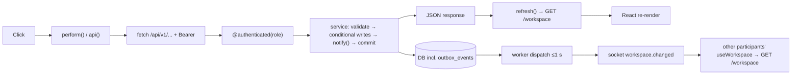

# 10 — Complete data flow

[← Back to index](README.md) · Next: [11 — Third-party integrations →](11-third-party-integrations.md)

Each flow is traced through the same 14 steps: (1) user action, (2) component, (3) handler, (4) data collection, (5) client validation, (6) endpoint, (7) controller, (8) service logic, (9) database, (10) external services, (11) response, (12) frontend receipt, (13) UI update, (14) errors. Diagrams for each flow are in [diagrams/](README.md#diagrams).

## The universal pattern

The initiating client updates from its own refresh; **other** users update via the outbox → socket → refetch path (or their 2 s/15 s poll).

---

## Flow 1 — Login

| Step | Detail |
| --- | --- |
| 1 | User submits the `/login` form |
| 2 | `main.jsx::AuthPage` |
| 3 | `submit(event)` → `signIn(fields)` (`authSession.js`) |
| 4 | `Object.fromEntries(new FormData(form))` → `{mobile, password}` |
| 5 | HTML `required`, `maxLength=128` |
| 6 | `POST /api/v1/auth/login` with `X-Session-Request: 1` |
| 7 | `routes.sign_in` (+ `limit_auth` before_request, `check_origin(require_header=False)`) |
| 8 | `services.login`: normalize mobile, constant-work password check, disabled check → `session_service.issue` |
| 9 | SELECT `users`; INSERT `auth_sessions`, `refresh_tokens`; COMMIT |
| 10 | none |
| 11 | 200 `{access_token, expires_in, expires_at, user}` + `Set-Cookie ridez_refresh` |
| 12 | `request()` parses JSON; `signIn` bumps `generation`, clears `knownTokens`, `publish(data)` |
| 13 | `AuthProvider` listener sets `session`; `AuthPage` → `navigate('/{role}')` → `Protected` → `Workspace` |
| 14 | 401 → `setError('Mobile or password is incorrect')`; 429 → rate-limit message; 403 → origin message |

## Flow 2 — Getting a fare quote

| Step | Detail |
| --- | --- |
| 1 | Rider fills pickup/destination and clicks "Get fare estimate" |
| 2 | `BookingPanel` |
| 3 | `submit(event)` |
| 4 | `form` state: labels from `AddressSearch.onChoose`/map `select()`/typing; coordinates as strings |
| 5 | Both coordinate pairs required in Google mode (pickup only in simulator) → else inline error |
| 6 | `perform('/fares/quotes', {pickup, destination, pickup_lat, pickup_lng, destination_lat?, destination_lng?})` → `POST /api/v1/fares/quotes` |
| 7 | `ride_routes.quote`: `@authenticated('rider')`, 10/min limiter |
| 8 | `ride_service.quote`: `simulator()` guard, `text()`, `coordinate()`, pickup≠destination, `expire()`, `route_provider.compute`, `fare_service.calculate` (policy, zones, traffic, demand) |
| 9 | Reads `fare_policies` (+ demand tables); INSERT `fare_quotes`; COMMIT |
| 10 | Google Routes `computeRoutes` (Google mode) |
| 11 | 201 `{quote: {...itemized, expires_at, polyline}}` |
| 12 | `perform` returns response; `refresh()` also called |
| 13 | `setQuote(response.quote)` → "Your fare, upfront." card; map draws polyline |
| 14 | `actionError` banner with backend message (e.g. "The route service timed out. Try again shortly"); no simulated fallback in Google mode |

## Flow 3 — Booking and matching

| Step | Detail |
| --- | --- |
| 1 | Rider clicks "Confirm ride" |
| 2 | `BookingPanel` quote card |
| 3 | inline `onClick` → `perform('/rides', {quote_id})` |
| 4 | `quote.id` from Flow 2 |
| 5 | Button disabled while busy |
| 6 | `POST /api/v1/rides` |
| 7 | `ride_routes.book` (`@authenticated('rider')`) |
| 8 | `ride_service.book`: ownership, idempotency, expiry, provider, active-claim check → create ride → `matching.invite` → `notify_ride` |
| 9 | INSERT `rides`, `active_rides`, `ride_match_rounds`, `ride_invitations`; no-op UPDATE `users` (driver locks); INSERT `outbox_events`; COMMIT |
| 10 | none |
| 11 | 201 `{ride}` (SEARCHING) |
| 12 | `perform` → `setQuote(null)`, `refresh()` |
| 13 | `/workspace` now has `active_ride` → `ActiveRidePanel` with countdown; `trip_otp` card. **Drivers** receive `workspace.changed` within ~1 s → their `/workspace` includes `invitations` → "New ride request" card |
| 14 | 409 messages (expired quote, already active, provider changed) in the banner; quote stays visible |

Background continuation: every second `matching.advance()` expires the round; radius grows; new invitations; eventually NO_DRIVER_FOUND (rider claim released, rider sees "No driver found" and the booking form returns).

## Flow 4 — Driver location update

| Step | Detail |
| --- | --- |
| 1 | Timer (30 s idle / 10 s on trip) — no click |
| 2 | `RideWorkspace` → `useDriverLocation` |
| 3 | `send()` |
| 4 | `getPosition()` → `navigator.geolocation.getCurrentPosition` |
| 5 | Secure context check; geolocation errors mapped to messages |
| 6 | `PUT /api/v1/driver/location` `{latitude, longitude, accuracy_m, recorded_at}` |
| 7 | `ride_routes.location` (`@authenticated('driver')`) |
| 8 | `location_service.update`: status/availability rules, bounds, time window, ordering, plausibility, replay |
| 9 | UPSERT `driver_locations`; INSERT `outbox_events`; COMMIT (in the route) |
| 10 | Browser geolocation only |
| 11 | 200 `{location:{fresh, recorded_at, accuracy_m}}` |
| 12 | Error cleared |
| 13 | Next `/workspace` shows "Location fresh" + time + accuracy |
| 14 | Error banner (`trackingError`); permission denied → `POST /driver/availability {available:false}` |

## Flow 5 — Driver accepts a ride

| Step | Detail |
| --- | --- |
| 1 | Driver clicks "Accept ride" |
| 2 | Invitation card in `RideWorkspace` |
| 3 | `perform('/rides/{id}/accept')` |
| 4 | ride id from `data.invitations` |
| 5 | Button disabled when `expires_at` passed |
| 6 | `POST /api/v1/rides/{id}/accept` |
| 7 | `ride_routes.accept` (`@authenticated('driver')`) |
| 8 | `ride_service.accept` guards → `lock_active_driver` → `ride_repository.assign` (conditional) |
| 9 | UPDATE `rides`; INSERT `active_rides`; UPDATE `ride_invitations`, `driver_presence`, `ride_match_rounds`; INSERT outbox; COMMIT |
| 10 | none |
| 11 | 200 `{ride}` ASSIGNED with vehicle snapshot |
| 12 | `refresh()` |
| 13 | Driver: `ActiveRidePanel` with "Head to pickup". Rider (via socket): `AssignedRideDetails` with driver name, rating, car plate, fare, OTP. Other invited drivers: invitation disappears |
| 14 | 409 "Another driver has already accepted this ride" etc. |

## Flow 6 — Starting the trip with OTP

| Step | Detail |
| --- | --- |
| 1 | Rider reads OTP to driver; driver types 6 digits and clicks "Start trip" |
| 2 | `RideCard` + `OtpInput` |
| 3 | button `onClick` → `perform('/rides/{id}/start', {otp})` |
| 4 | `otp` state from `OtpInput.onChange` |
| 5 | Button disabled until `otp.length === 6` |
| 6 | `POST /api/v1/rides/{id}/start` |
| 7 | `ride_routes.progress` → `body()` required for start |
| 8 | `ride_service.move`: assigned driver check → `verify_trip_otp` (rate limit, HMAC compare) → `transition(WAITING→IN_PROGRESS)` |
| 9 | UPDATE `rides`; outbox; COMMIT |
| 10 | none |
| 11 | 200 `{ride}` |
| 12–13 | Driver sees "Complete trip"; map switches to driver→destination; rider sees "You're on your way"; OTP no longer shown |
| 14 | 400 wrong OTP; 429 after 5 failures/min |

## Flow 7 — Completion and cash payment

| Step | Detail |
| --- | --- |
| 1 | Driver clicks "Complete trip" and confirms |
| 2–3 | `RideCard` → `perform('/rides/{id}/complete')` |
| 6–8 | `ride_service.move('complete')` → `revenue_service.allocate` + `payment_service.record_completion` + release + auto-availability |
| 9 | UPDATE `rides`; INSERT `revenue_ledger`, `ride_payments`; DELETE `active_rides`; UPDATE `driver_presence`; outbox; COMMIT |
| 11–13 | Driver: completion notice, `DriverCollectCard`. Rider: `usePaymentPrompt` detects the active ride turned COMPLETED/PENDING → `PaymentPrompt` modal |
| — | Rider clicks "Pay by cash" → `POST /rides/{id}/payment-method {method:'CASH'}` → UPDATE `ride_payments.method` |
| — | Driver clicks "Cash received" (confirm) → `POST /rides/{id}/confirm-cash` → conditional UPDATE to CONFIRMED |
| — | Rider modal (via socket refresh) shows `PaymentSuccess` + `RatingForm`; driver sees `PaymentConfirmedFlash`; earnings move from "Awaiting payment" to "Earnings received" |
| 14 | 409 "The rider has already paid online" if the mock QR won first |

## Flow 8 — Mock online payment

| Step | Detail |
| --- | --- |
| 1 | Rider chooses "Pay online" (or "Pay by QR (test)") |
| 3 | `PaymentPrompt.choose('ONLINE')` → `useTestQr.generate()` |
| 6 | `POST /rides/{id}/payment-method {ONLINE}` then `POST /rides/{id}/test-payment` |
| 8–9 | INSERT `mock_payments` PENDING; return signed path |
| 12–13 | `QRCode.toDataURL(absolute URL)` → QR image + "Open payment page" |
| — | Phone opens `/test-payment/<token>` → `TestPaymentPage` → `GET /test-payments/<token>` → shows amount |
| — | "Simulate success" → `POST /test-payments/<token> {status:'SUCCESS'}` → UPDATE `mock_payments`, `payment_service.confirm(ONLINE)`, notify |
| — | Rider modal flips to success via socket; driver earnings update |
| 14 | 410 expired token; 404 feature disabled; 409 already paid in cash |

## Flow 9 — Admin suspends a driver

| Step | Detail |
| --- | --- |
| 1 | Admin clicks "Suspend driver" on a row, types a reason, confirms |
| 2–3 | `DriverManagement.choose` → `save(event)` |
| 4 | `{version: selected.status_revision, reason}` |
| 5 | Reason required (button disabled when empty) |
| 6 | `POST /api/v1/admin/drivers/{id}/suspend` |
| 7 | `ride_routes.suspend_driver` (`@authenticated('admin')`) |
| 8 | `admin_service.change_driver_status` (version, retry detection, conditional UPDATE) → `session_service.stop_requests` |
| 9 | UPDATE `users`, `driver_presence`, `ride_invitations`; INSERT `admin_audit`, outbox; COMMIT |
| 11 | 200 `{user}` |
| 12–13 | Success message; list reloads; driver's workspace (via socket) shows "Your driver account is suspended" + reason; invitations disappear |
| 14 | 409 stale version → error + "Reload drivers" |

## Flow 10 — Rating

| Step | Detail |
| --- | --- |
| 1 | User taps stars, optional tags/comment, "Submit rating" |
| 2–3 | `RatingForm.submit` |
| 4 | `{stars, tags: chosen, comment?}` |
| 5 | Submit only visible after a star is chosen; ≤ 5 tags enforced in `toggle` |
| 6 | `POST /api/v1/rides/{id}/rating` |
| 7–8 | `ride_routes.rate` → `rating_service.submit` |
| 9 | INSERT `ride_ratings`; COMMIT (no outbox event) |
| 11–13 | `setSaved(data.rating)` → "You rated … Thanks!"; averages update on next workspace load |
| 14 | 409 already rated with different stars |

## Flow 11 — Admin edits fare policy

`FareSettings.save` → `PUT /admin/fare-settings {version, reason, policy}` → `fare_service.save` (version check, `validate`, INSERT `fare_policies` version+1, notify admins) → returns new settings → form reloads with new version; next quote uses it, existing quotes unchanged; audit list shows "Fare policy" entry with diff.

## Data visibility summary

| Data | Rider | Driver | Admin |
| --- | --- | --- | --- |
| Fare breakdown | ✓ | ✓ | ✓ |
| Revenue split (`settlement`) | ✗ | own rides | ✓ |
| Trip OTP | own active ride | ✗ | ✗ |
| Driver coordinates | via trip map (active ride) | own (implicitly) | ✗ (freshness only) |
| Vehicle snapshot | assigned ride | ✓ | ✓ |
| Rating average | of driver | of rider + own | of drivers |
| Rating comments | ✗ | ✗ | ✓ |
| Cancellation reason | ✓ | ✓ | ✓ |
| Mobile numbers | ✗ | ✗ | drivers' (admin list) |
