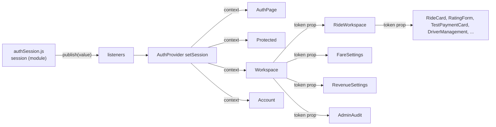

# 12 — State management and frontend flow

[← Back to index](README.md) · Next: [13 — Background and real-time processes →](13-background-and-realtime-processes.md)

## 1. Where state lives

| State | Location | Lifetime | Written by |
| --- | --- | --- | --- |
| Access token + user | `authSession.js` module variable `session` | Tab memory; lost on reload (restored via refresh cookie) | `signIn`, `refreshSession`, `signOut` |
| Refresh credential | HttpOnly cookie `ridez_refresh` | 30 days max | Server only |
| Session for React | `Auth` context in `main.jsx::AuthProvider` (`session, ready, restoreError, signingOut, logoutError`) | App lifetime | `subscribeSession` listener |
| Server snapshot | `useWorkspace` → `data` | While `RideWorkspace` is mounted | Polling + socket-triggered refetch |
| Action status | `RideWorkspace` local `busy`, `actionError`, `completed`, `availabilityChoice`, `dismissedCancellation`, `closedPayment` | Component | `perform`, handlers |
| Form drafts | Local `useState` in each form component | Component | User input |
| Admin page data | Local `data/policy/...` in `FareSettings`, `RevenueSettings`, `AdminAudit`, `DriverManagement` | Component | Their own `api()` calls |
| Rating tag list | `RatingTags` React context, value = `data.rating_tags` | Workspace | Server |
| Payment prompt dismissal | `sessionStorage['ridez.payment-dismissed.<rideId>']` | Tab | `rememberPaymentDismissed` |
| Trip map data | `useTripRoute` local state keyed by `ride.id:phase` | Active ride panel | Polling `/rides/{id}/map` |
| Google Maps instance | `googleMaps.js` module `loading` promise + `window.google` | Page | `loadMaps` |

There is **no global store** (Redux/Zustand/React Query). The design treats the server as the single source of truth and the client as a cache that is invalidated aggressively.

## 2. Global state: authentication

The token is passed as a prop, but `api()` always resolves it to the **current** token through `resolveToken`, so components holding an old token still work after rotation.

## 3. Server-state synchronization (the workspace)

- `useWorkspace(token)` keeps one `data` object = last `/workspace` response.
- Re-fetch triggers: initial mount; every 15 s (socket connected) or 2 s (disconnected); socket `connect`/`disconnect`; each new `workspace.changed` event (debounced 80 ms); any `perform()` success; the refresh button.
- No optimistic updates except `updateAvailability` (patches `available`/`resume_available` immediately after the availability POST).
- When `error` is set (last poll failed), all action buttons are disabled and the banner explains "Actions are paused until the connection recovers".

## 4. Local component state patterns

| Pattern | Example |
| --- | --- |
| `busy` flag + disabled buttons | `perform`, `FareSettings.save`, `RatingForm.submit`, `VehicleEditor.save` |
| `error` string rendered in `role="alert"` | every form |
| `message` string for success | admin pages |
| AbortController in effects | `useWorkspace` poll, `useTripRoute`, `AdminAudit`, `DriverManagement`, `useDriverLocation` |
| Monotonic sequence refs to ignore stale async results | `AddressSearch` (`sequence`, `selection`) |
| "previous value" refs to detect transitions | `usePaymentPrompt` (`lastActive`), `usePaymentConfirmedFlash` (`pending`) |
| `revision` counter to force refetch | `useWorkspace`, `AdminAudit`, `DriverManagement`, `useTripRoute` |
| `key` prop to reset component state | `OtpInput key={ride.id}`, `VehicleEditor key={id:version}`, `PaymentPrompt key={ride.id}`, `AuthPage key="login"/"register"` |

## 5. Passing data between components

- Top-down props only. `RideWorkspace` passes `ride`, `role`, `perform`, `disabled`, `token`, `tripOtp` into cards.
- Callbacks up: `onSelect`/`onChoose` (map/address → BookingPanel), `onChange` (OtpInput → RideCard), `onReview` (CancelRideControl hides action buttons), `onChanged`/`onSaved` (DriverManagement/VehicleEditor → workspace refresh), `onClose` (PaymentPrompt).
- Two contexts: `Auth` (session) and `RatingTags`.
- `ActiveRidePanel` lifts the trip-map poll (`useTripRoute`) so `TripStatsCard` and `TripRouteMap` share one request.

## 6. Loading states

| Situation | UI |
| --- | --- |
| Session restoring | `SessionLoading` "Restoring your session…" |
| Workspace first load | "Loading your workspace…" |
| Workspace failed before first data | "Unable to load your workspace. Use refresh to retry." |
| Button actions | Labels change: "Please wait…", "Saving…", "Submitting…", "Generating…", "Signing out…", "Getting your location…" |
| Maps | "Loading Google Maps…", "Loading Google road route…" |
| Address search | "Searching addresses…", "Loading selected address…" |
| Admin lists | "Loading drivers…", "Loading audit history…", "Loading fare settings…" |

## 7. Error states

All backend errors arrive as `Error(message)` from `api()`. Each component shows the message near the action. Special cases:
- `Protected`: session restore failure (network) → message + "Retry restoring session" + "Sign in again".
- `useDriverLocation`: geolocation errors mapped to human messages (denied, unavailable, timeout).
- Google map errors: "Retry map" button.
- 409 conflicts on admin pages: "Reload settings" / "Reload drivers" buttons.

## 8. Forms

All forms are **uncontrolled-to-controlled hybrids** with `useState` and native HTML validation attributes; there is no form library. Submission always `event.preventDefault()`, sets `busy`, calls the API, then resets or shows the error. Details per form: [04 §11](04-frontend-documentation.md#11-forms-and-validation).

## 9. Navigation and routing

- `BrowserRouter` with role prefixes; `Navigate replace` for redirects (no history spam).
- After login: `navigate('/{role}', {replace:true})`.
- `NavLink end` highlights the active sidebar item; mobile menu toggled by `open` state.
- Unknown nested paths render `ComingSoon`; unknown top-level paths render the 404 page.
- Production server mirrors SPA paths (`web.py`), so deep links survive reloads.

## 10. Reusable component structure

| Reusable | Used in |
| --- | --- |
| `GoogleRouteMap` | `BookingPanel` (picker) and `TripRouteMap` (read-only) |
| `QuoteDetails` (passed as prop to `BookingPanel`) | Booking, ride cards, invitations |
| `RideCard` | Overview, history, admin rides, recent trip |
| `RatingBadge`, `StarsShown` | Assigned details, invitations, driver list, admin ratings |
| `RatingForm` | Ride cards and payment success |
| `CancellationNotice` | Ride cards and recent banner |
| `Countdown` | Searching rides and invitations |
| `getPosition` | Driver availability and rider "Use my location" |
| `api` | All network calls |

## 11. Important interactions traced UI → backend → UI

| Interaction | UI → API → UI |
| --- | --- |
| Go available | button → `getPosition` → `POST /driver/availability` → `updateAvailability` + refresh → banner "You're available for requests"; GPS loop starts |
| Accept invitation | card button → `POST /rides/{id}/accept` → refresh → `ActiveRidePanel` |
| Rider waits for driver | socket event → refetch → `AssignedRideDetails` appears without clicking |
| Driver completes | button + confirm → `POST /complete` → rider socket refetch → `usePaymentPrompt` opens modal |
| Admin suspends | form → `POST /suspend` → `onChanged()` refresh metrics → driver socket refetch → suspension banner |
