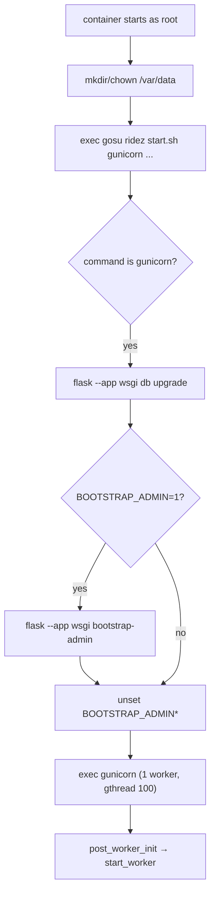
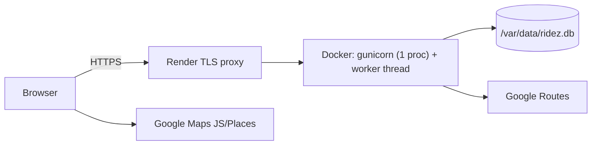

# 15 — Application execution and deployment

[← Back to index](README.md) · Next: [16 — Dependencies →](16-dependencies.md) · Diagrams: [diagrams/architecture.md](diagrams/architecture.md#3-deployment-topology-render-blueprint-renderyaml)

Commands below are copied from `README.md`, `Dockerfile`, `deploy/*.sh`, `render.yaml` and `.github/workflows/checks.yml`. Items marked **(recommended)** are suggestions, not existing configuration.

## 1. Prerequisites

| Software | Version | Source |
| --- | --- | --- |
| Python | 3.12 (`.python-version` 3.12.12); 3.14 unsupported by pinned `pyodbc` | README |
| Node.js | 20.19+ (22.12+ recommended); `.node-version` 22 | README |
| npm | bundled with Node | |
| Docker | for image builds and `deploy/smoke.py` | CI |
| Google Cloud project | Routes API (server key); Maps JavaScript API + Places API (New) (browser key) | `docs/GOOGLE_MAPS_SETUP.md` |
| Microsoft ODBC Driver 18 | only if using SQL Server (not in the image) | README |

## 2. Environment variables

### Backend (`backend/.env` locally, platform env in production)

| Variable | Default | Purpose |
| --- | --- | --- |
| `APP_ENV` | `development` | Anything else = production rules |
| `DATABASE_URL` | dev: `sqlite:///ridez.db`; prod: **required** | SQLAlchemy URL |
| `JWT_SECRET` | dev: auto-generated `instance/jwt.key`; prod: **required ≥ 32 chars** | JWT + QR token signing |
| `USER_CODE_SECRET` | dev: auto `instance/codes.key`; prod: **required ≥ 32, ≠ JWT_SECRET** | Account codes and trip OTPs |
| `ROUTE_PROVIDER` | dev `simulator`, prod `google` | `google` or `simulator` |
| `GOOGLE_MAPS_SERVER_KEY` | empty; required in prod with Google | Routes API |
| `SIMULATOR_ENABLED` | dev `1`, prod `0` | Allow simulated quotes/bookings |
| `TEST_PAYMENTS_ENABLED` | dev `1`, prod `0` | Mock QR payments and ONLINE method |
| `MATCH_MAX_RADIUS_M` | `5000` | Multiple of 500 in 500–10000 |
| `AUTH_TRUSTED_ORIGINS` | empty | Extra allowed Origins (comma-separated) |
| `TRUST_PROXY_HEADERS` | `0` | `1` behind exactly one trusted TLS proxy (Render) |
| `PORT` | `5000` (`run.py`), `10000` (Gunicorn/Docker) | Listen port |
| `BOOTSTRAP_ADMIN`, `BOOTSTRAP_ADMIN_MOBILE`, `BOOTSTRAP_ADMIN_NAME`, `BOOTSTRAP_ADMIN_PASSWORD` | unset | Startup admin creation |

Not configurable by env (hard-coded config defaults): `REFRESH_SESSION_DAYS=30`, `LOCATION_STALE_SECONDS=90`, `MATCH_ROUND_SECONDS=30`, `AUTH_COOKIE_SECURE` (= production), `FRONTEND_DIST`.

### Frontend (`frontend/.env.local`, or Docker build args)

| Variable | Purpose |
| --- | --- |
| `VITE_GOOGLE_MAPS_BROWSER_KEY` | Browser Maps/Places key (public; restrict by referrer) |
| `VITE_GOOGLE_MAP_ID` | Optional Map ID (default `DEMO_MAP_ID`) |
| `API_PROXY_TARGET` | Vite dev proxy target (default `http://127.0.0.1:5000`) |

## 3. Local development (verified commands from README)

**Backend (Linux/macOS):**

```sh
python3 -m venv backend/.venv
backend/.venv/bin/pip install -r backend/requirements.lock
cd backend
.venv/bin/flask --app run db upgrade
.venv/bin/python run.py            # API + Socket.IO + matching worker on :5000
```

**Frontend (second terminal):**

```sh
cd frontend
npm ci
npm run dev                        # Vite on :5173, proxies /api and /socket.io to :5000
```

Open `http://localhost:5173`. Port 5000's root returns JSON 404 locally (no SPA build there).

**Create an admin:** `cd backend && .venv/bin/flask --app run create-admin`.

**Windows:** the README provides PowerShell equivalents (`py -3.12 -m venv backend\.venv312`, `npm.cmd ci`, …).

**Gotchas:**
- Use `python run.py`, not `flask run` (the latter does not start the worker).
- Geolocation needs `localhost` or HTTPS.
- If port 5000 is occupied, set `PORT` for `run.py` and `API_PROXY_TARGET` for Vite **(recommended)**.

## 4. Tests and build

```sh
cd backend && .venv/bin/python -m pytest -q
cd ../frontend && npm run build    # outputs frontend/dist
```

Tests use SQLite only; they do not establish SQL Server behaviour (README). Live Google calls are mocked.

## 5. Production image (Docker)

```sh
docker build -t ridez:local .
python deploy/smoke.py --image ridez:local
```

Build stages (`Dockerfile`):
1. `node:22-bookworm-slim`: `npm ci --strict-ssl=true` (optional `proxy_ca` build secret), copy source, `ARG VITE_GOOGLE_MAPS_BROWSER_KEY`, `ARG VITE_GOOGLE_MAP_ID`, `npm run build`.
2. `python:3.12-slim-bookworm`: `APP_ENV=production`, `PORT=10000`; install `libodbc2 ca-certificates gosu`; user `ridez` (uid/gid 10001); `pip install -r requirements.lock`; copy backend app, migrations, `wsgi.py`, `gunicorn.conf.py`, `start.sh`, `backup.py`, SPA → `/app/frontend_dist`; create `/var/data`, `/app/instance` owned by `ridez`.
3. `HEALTHCHECK` every 30 s → `GET /api/v1/ready` (start period 45 s).
4. `ENTRYPOINT /app/start.sh`, `CMD gunicorn --config gunicorn.conf.py wsgi:app`.

**Startup sequence (`deploy/start.sh`):**



Migrations run at **runtime** (not build) because Render attaches the persistent disk only at runtime.

## 6. Render deployment (verified configuration)

**Blueprint (`render.yaml`):** Docker runtime, plan `starter`, `numInstances: 1`, `autoDeploy: false`, `healthCheckPath: /api/v1/ready`, disk `ridez-data` 1 GB at `/var/data`, env: `APP_ENV=production`, `DATABASE_URL=sqlite:////var/data/ridez.db`, `JWT_SECRET`/`USER_CODE_SECRET` generated, `TRUST_PROXY_HEADERS=1`, `ROUTE_PROVIDER=google`, `SIMULATOR_ENABLED=0`, `GOOGLE_MAPS_SERVER_KEY` and `VITE_GOOGLE_MAPS_BROWSER_KEY` set manually.

**Native Python alternative** (from `docs/RENDER_DEPLOYMENT.md`): Build `sh deploy/render-build.sh`, Start `sh deploy/render-start.sh`, health `/api/v1/ready`, `PYTHON_VERSION=3.12.12`, `NODE_VERSION=22`.

**First admin:** Render Shell `gosu ridez python -m flask --app wsgi create-admin`, or env bootstrap (then set `BOOTSTRAP_ADMIN=0` and remove credentials).

**Post-deploy checks** (from the deployment guide): `/` and deep links load; `/api/v1/ready` = 200 with `database:true, matching_worker:true`; full ride flow; restart persistence; Socket.IO reaches WebSocket transport.

## 7. Deployment architecture



One origin serves SPA + API + WebSocket; no CDN, no separate static site, no CORS.

## 8. CI pipeline (`.github/workflows/checks.yml`)

1. checkout → setup Python 3.12 and Node 22 (npm cache)
2. `python -m pip install -r backend/requirements.lock`
3. `python -m pytest -q` (in `backend`)
4. `npm ci && npm run build` (in `frontend`)
5. `docker build -t ridez:ci .`
6. `python deploy/smoke.py --image ridez:ci` — runs the container with simulator mode, bootstrap admin, checks readiness, admin login, bootstrap env removal, SPA deep links, register/login, Secure+HttpOnly cookie, quote → book → cancel, OTP persistence across `docker restart`, refresh, logout revocation.

## 9. Logging and monitoring

| Aspect | Current state |
| --- | --- |
| Access logs | Disabled (`accesslog = None`) to avoid logging Socket.IO session IDs / URLs |
| Error logs | Gunicorn `errorlog='-'` (stderr), `capture_output=True` |
| App logs | Only the worker failure message; no structured logging |
| Health | `/api/v1/health` (liveness + config), `/api/v1/ready` (schema + worker) |
| Metrics/APM/alerts | None **(recommended: add error tracking and uptime alerts)** |

## 10. Backups and recovery

`gosu ridez python backup.py /var/data/backups/<new-name>.db` in Render Shell. Backups on the same disk are not disaster recovery; download copies off-host. Restore the DB **together with** its `JWT_SECRET`/`USER_CODE_SECRET`. Image rollbacks don't roll back the schema; the suspension migration refuses downgrade while drivers are suspended.

## 11. Hosting requirements and limits

- Exactly one process/instance (in-process sockets, limiters, caches).
- Persistent disk for SQLite; ephemeral free instances lose data.
- HTTPS (Secure cookies, geolocation).
- Outbound HTTPS to `routes.googleapis.com`.
- Scaling beyond one instance requires a shared Socket.IO message queue (e.g. Redis), shared rate limiting, a server database and worker ownership — **not implemented**.
