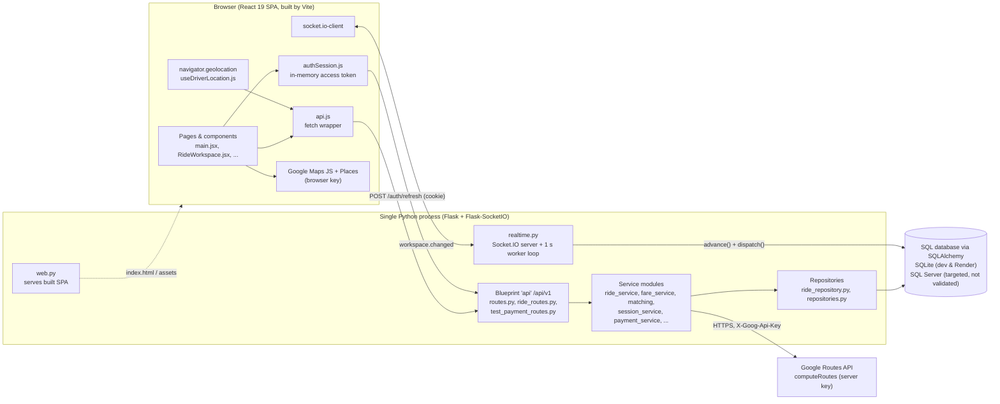
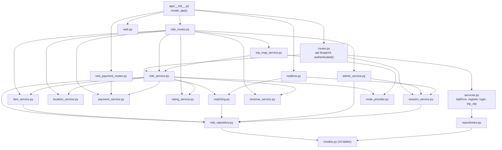
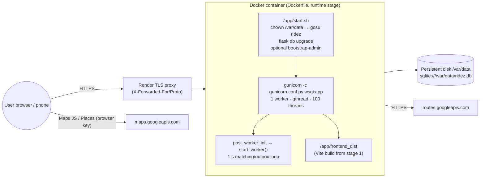
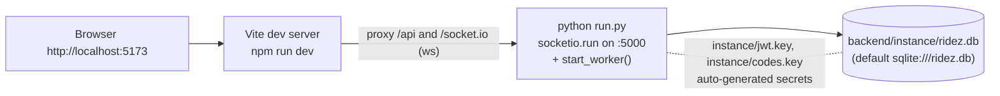

# Architecture diagrams

[← Back to index](../README.md)

## 1. High-level system

## 2. Backend module dependency graph

Arrows mean "imports / calls".

## 3. Deployment topology (Render Blueprint, `render.yaml`)

## 4. Local development topology

Note: Flask-SQLAlchemy resolves the relative SQLite URL `sqlite:///ridez.db` inside the Flask instance folder (`backend/instance/`). **(inferred from Flask-SQLAlchemy 3.x behaviour; the `instance/` folder in this checkout contains the generated key files.)**
