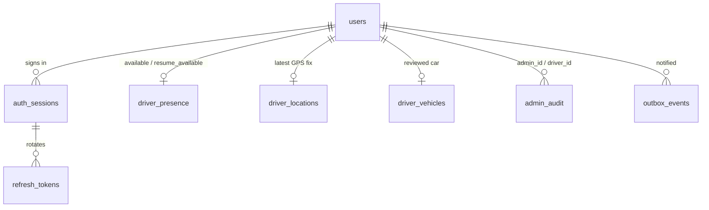
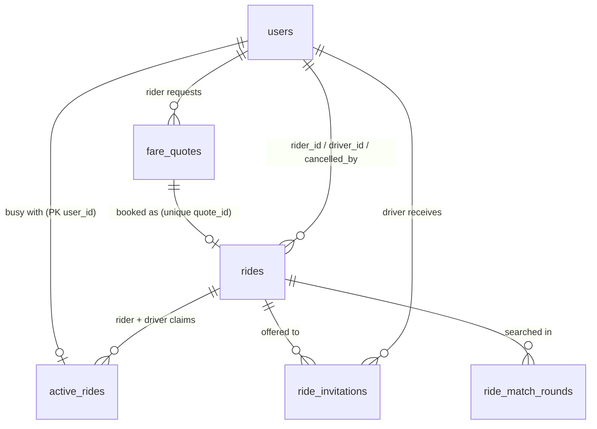
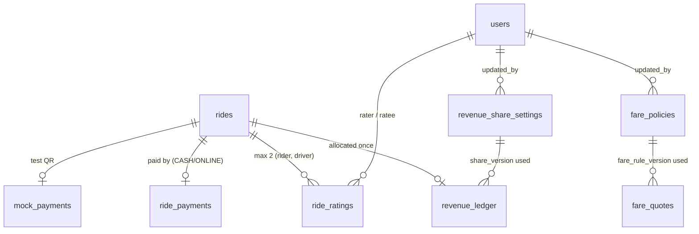

# Entity-relationship diagram

[← Back to index](../README.md) · Full column reference: [07 — Database documentation](../07-database-documentation.md)

All tables are defined in `backend/app/models.py` and created by the Alembic migrations in `backend/migrations/versions/`.

```mermaid
erDiagram
  users {
    int id PK
    string name
    string mobile UK "E.164"
    string password_hash
    string user_code UK "RID-/DRV-/ADM-"
    string role "rider|driver|admin"
    string status "active|pending|disabled|suspended"
    int status_revision
    datetime created_at
  }
  driver_presence {
    int driver_id PK,FK
    bool available
    bool resume_available
  }
  driver_locations {
    int driver_id PK,FK
    float latitude
    float longitude
    float accuracy_m
    datetime recorded_at
    datetime updated_at "indexed"
    bool fresh
  }
  driver_vehicles {
    int driver_id PK,FK
    string registration
    string model
    string color
    int version
  }
  fare_quotes {
    string id PK "UUID"
    int rider_id FK
    string pickup
    string destination
    decimal total
    datetime expires_at
    string provider "google|simulator"
    int fare_rule_version
    text rate_snapshot
  }
  fare_policies {
    int version PK
    text settings "JSON"
    int updated_by FK
    string reason
    datetime created_at
  }
  rides {
    string id PK "UUID"
    int rider_id FK
    int driver_id FK "nullable"
    string quote_id FK,UK
    string status
    datetime expires_at "current round deadline"
    int round_no
    int radius_m
    int cancelled_by FK
  }
  active_rides {
    int user_id PK,FK
    string ride_id FK
  }
  ride_invitations {
    string ride_id PK,FK
    int driver_id PK,FK
    string status
    int round_no
    datetime expires_at
  }
  ride_match_rounds {
    string ride_id PK,FK
    int round_no PK
    int radius_m
    datetime started_at
    datetime expires_at
    string outcome
  }
  outbox_events {
    string id PK
    int user_id FK "NULL = admins room"
    datetime created_at
    datetime delivered_at "indexed"
  }
  revenue_ledger {
    string ride_id PK,FK
    int driver_id FK
    decimal eligible_fare
    decimal driver_amount
    decimal company_amount
    int share_version
  }
  revenue_share_settings {
    int version PK
    decimal driver_pct
    decimal company_pct
    datetime effective_from "indexed"
    int updated_by FK
  }
  admin_audit {
    string id PK
    int admin_id FK
    int driver_id FK
    string action
    string reason
    int status_revision
    text details "JSON"
  }
  auth_sessions {
    string id PK
    int user_id FK "indexed"
    datetime expires_at
    datetime revoked_at
  }
  refresh_tokens {
    string token_hash PK "SHA-256"
    string session_id FK "indexed"
    datetime used_at
  }
  ride_payments {
    string ride_id PK,FK
    string method "CASH|ONLINE|UNRECORDED"
    string status "PENDING|CONFIRMED"
    decimal amount
    int confirmed_by FK
  }
  mock_payments {
    string ride_id PK,FK
    decimal amount
    string status "PENDING|FAILED|SUCCESS"
  }
  ride_ratings {
    string ride_id PK,FK
    string rater_role PK "rider|driver"
    int rater_id FK
    int ratee_id FK "indexed"
    int stars "1..5"
  }

  users ||--o| driver_presence : "has (drivers)"
  users ||--o| driver_locations : "latest fix (drivers)"
  users ||--o| driver_vehicles : "reviewed car (drivers)"
  users ||--o{ fare_quotes : "requests"
  users ||--o{ rides : "rides as rider"
  users |o--o{ rides : "drives as driver"
  fare_quotes ||--o| rides : "booked as (unique)"
  users ||--o| active_rides : "busy with"
  rides ||--o{ active_rides : "claimed by rider+driver"
  rides ||--o{ ride_invitations : "offered to"
  users ||--o{ ride_invitations : "receives"
  rides ||--o{ ride_match_rounds : "searched in"
  users ||--o{ outbox_events : "notified"
  rides ||--o| revenue_ledger : "allocated in"
  users ||--o{ revenue_ledger : "earns"
  users ||--o{ revenue_share_settings : "updated_by"
  users ||--o{ fare_policies : "updated_by"
  users ||--o{ admin_audit : "admin_id / driver_id"
  users ||--o{ auth_sessions : "signs in"
  auth_sessions ||--o{ refresh_tokens : "rotates"
  rides ||--o| ride_payments : "paid by"
  rides ||--o| mock_payments : "test QR"
  rides ||--o{ ride_ratings : "rated (max 2)"
  users ||--o{ ride_ratings : "rater / ratee"
```

## Domain views (same tables, split for readability)

### Accounts, sessions and driver state

### Quotes, rides and matching

### Money, settings and feedback

`share_version` and `fare_rule_version` are recorded version numbers, not database foreign keys (version 0 means "built-in defaults", which have no row).

### Reading notes

- `active_rides` has **at most two rows per ride** (rider + assigned driver) and **at most one row per user** (primary key `user_id`). This is the database-level guarantee that nobody has two active rides.
- `rides.quote_id` is **unique**, which makes the quote ID the booking idempotency key.
- `ride_ratings` primary key `(ride_id, rater_role)` allows exactly one rating from the rider and one from the driver per ride.
- `fare_policies.version` and `revenue_share_settings.version` are **manually assigned** (`autoincrement=False`); the primary key collision on concurrent saves is the optimistic-concurrency guard.
- `outbox_events.user_id = NULL` means "send to the `admins` Socket.IO room".
