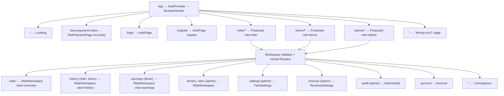
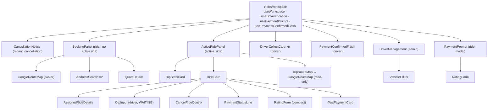
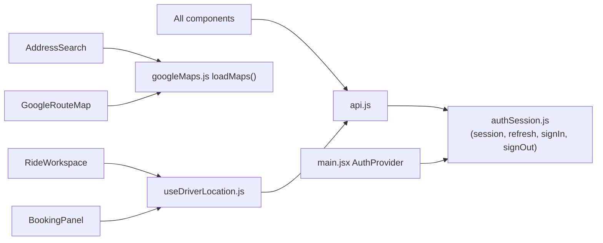

# Frontend diagrams

[← Back to index](../README.md) · Details: [04 — Frontend documentation](../04-frontend-documentation.md)

## Route tree (`frontend/src/main.jsx::App`)

## Component tree of `RideWorkspace`

## Shared modules

