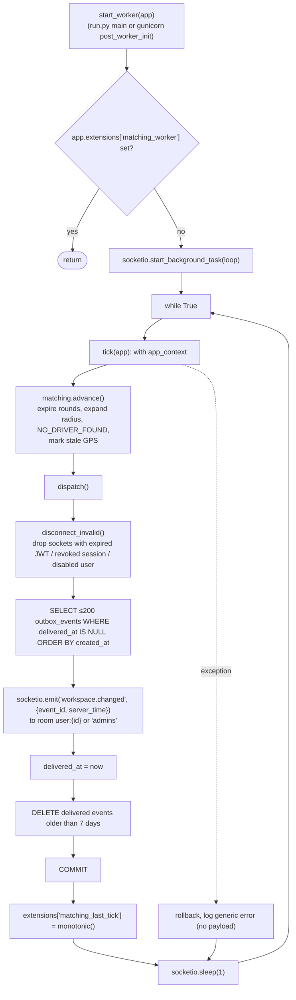
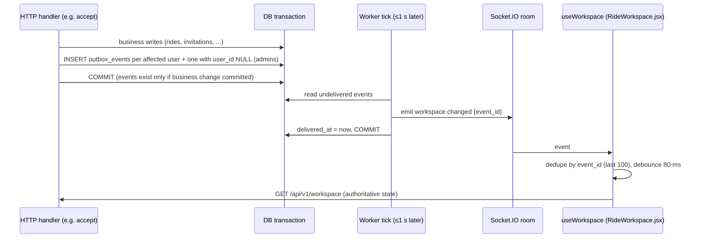
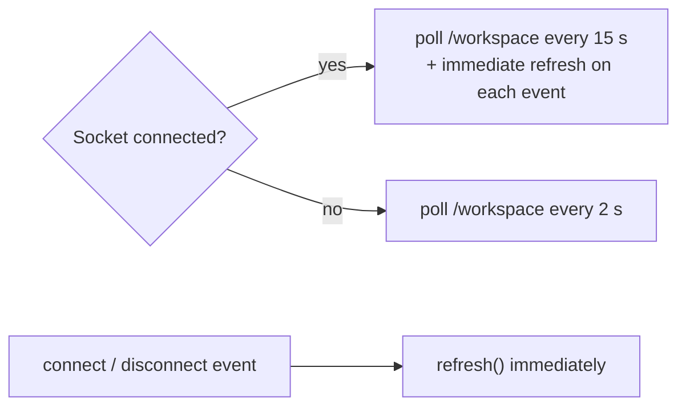

# Real-time and background processing diagrams

[← Back to index](../README.md) · Details: [13 — Background and real-time processes](../13-background-and-realtime-processes.md)

## Worker loop (`backend/app/realtime.py`)

## Transactional outbox pattern

## Client freshness strategy

