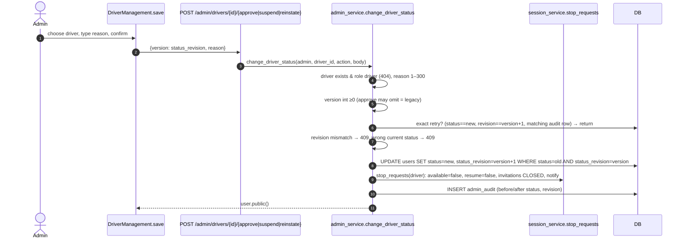
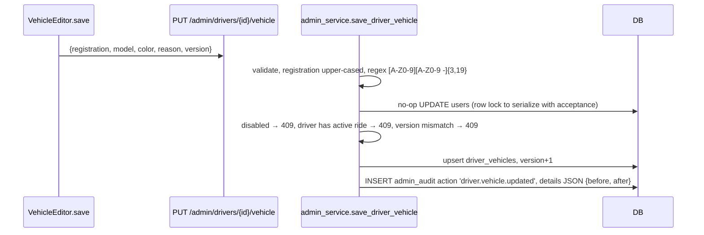
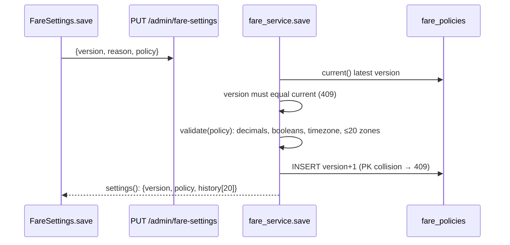
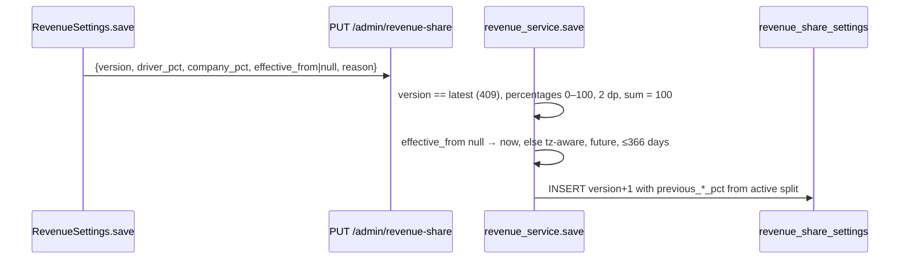
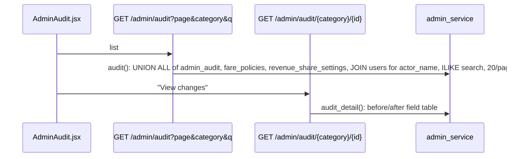

# Admin sequence diagrams

[← Back to index](../README.md)

## Approve / suspend / reinstate a driver

## Save vehicle details

## Fare policy save (optimistic concurrency)

## Revenue share save

## Audit history

