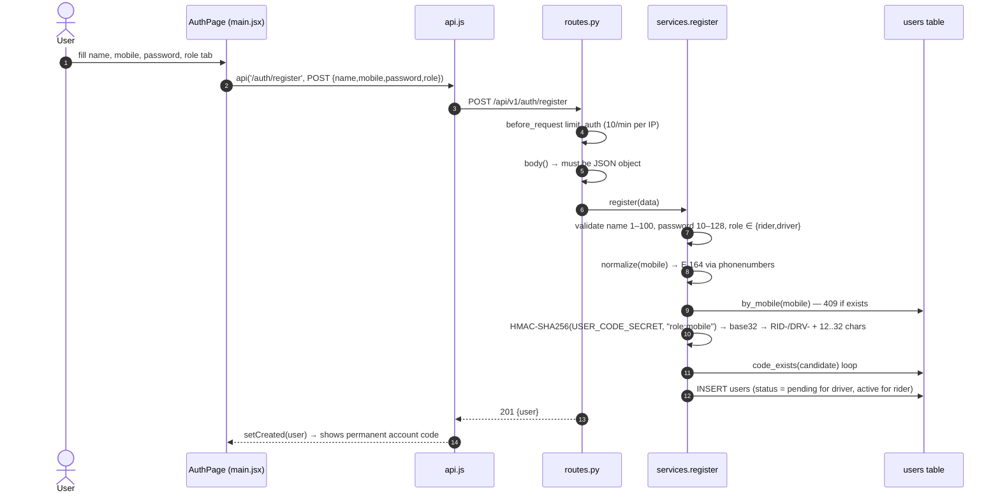
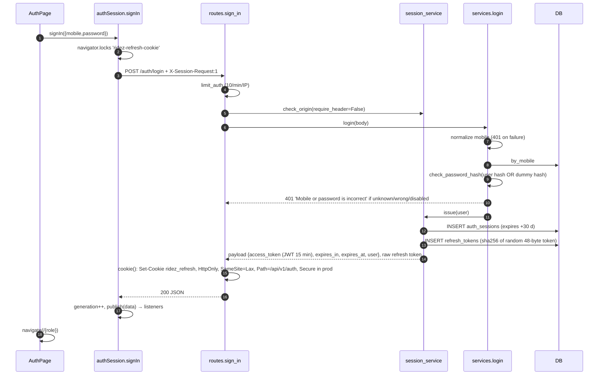
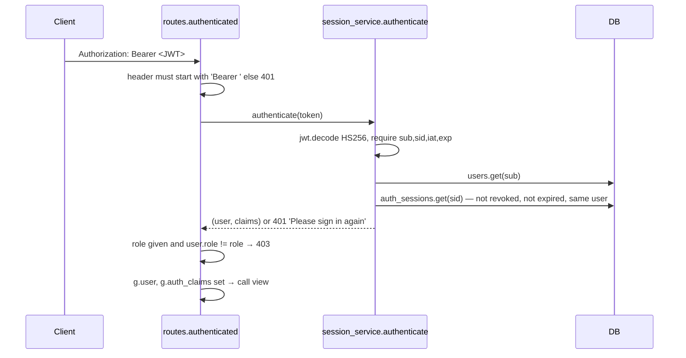
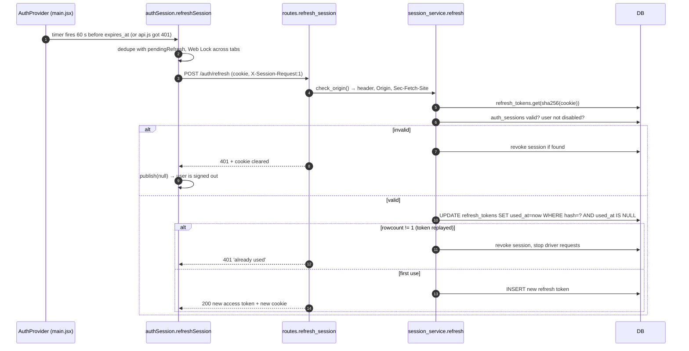
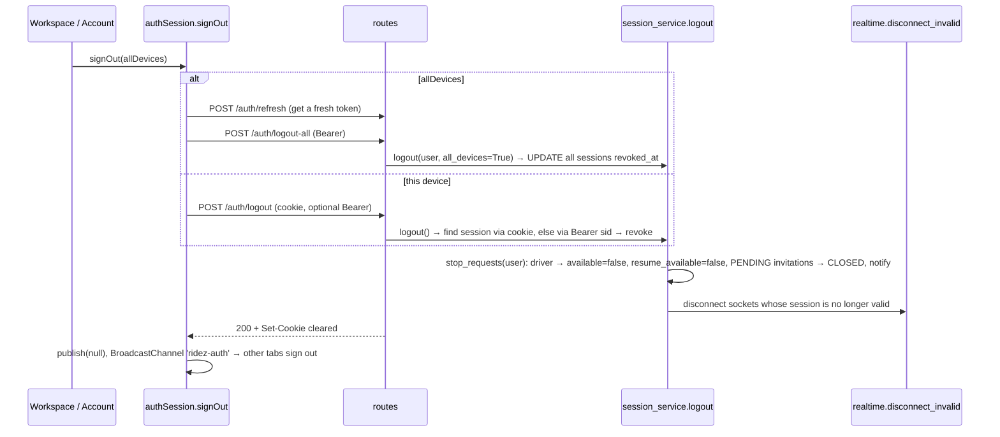

# Authentication sequence diagrams

[← Back to index](../README.md) · Details: [08 — Authentication and security](../08-authentication-and-security.md)

## Registration

## Login

## Authenticated request (`@authenticated(role)`)

## Silent refresh and single-use rotation

## Logout and logout-all

