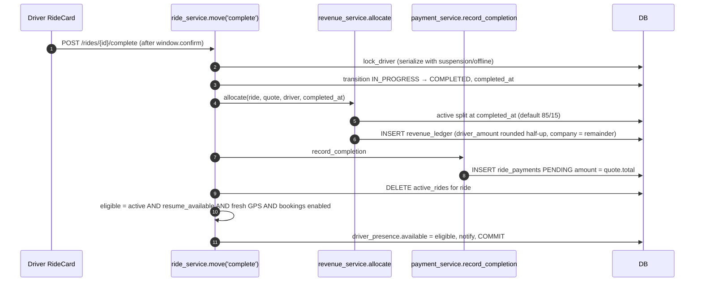
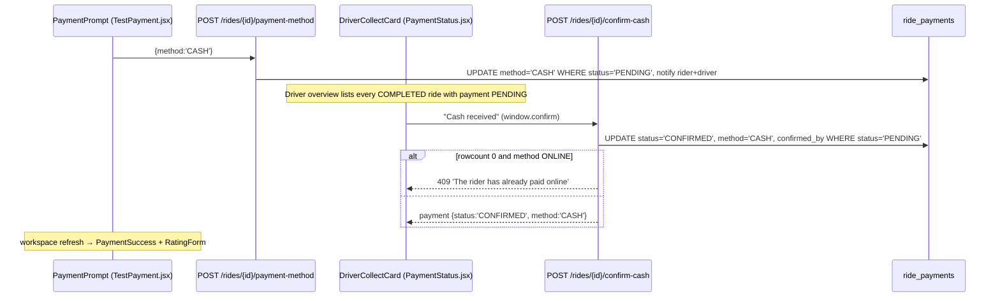
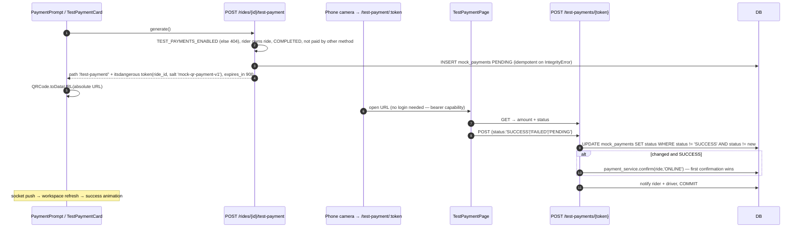
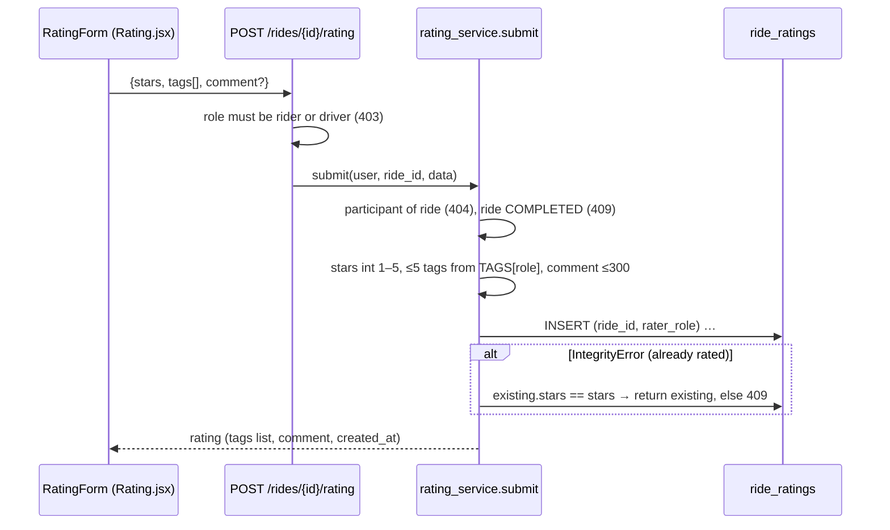

# Completion, payment and rating sequence diagrams

[← Back to index](../README.md)

## Trip completion

A retried `complete` returns the existing ride: `ride.status == new` short-circuits before any writes. The `revenue_ledger` and `ride_payments` primary keys (`ride_id`) are a second line of defence against double allocation.

## Rider pays in cash

## Rider pays "online" (mock QR, test only)

## Two-way rating

