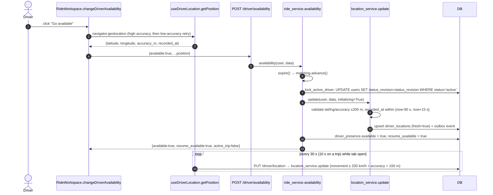
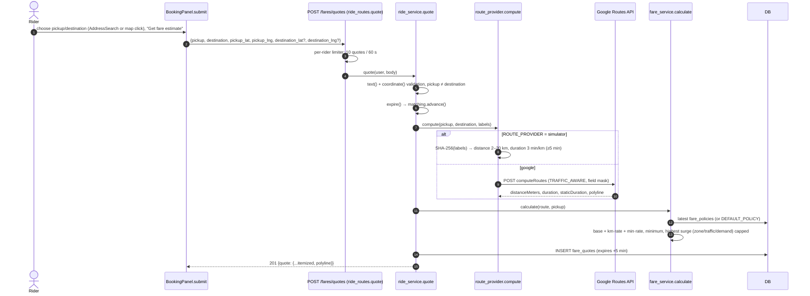
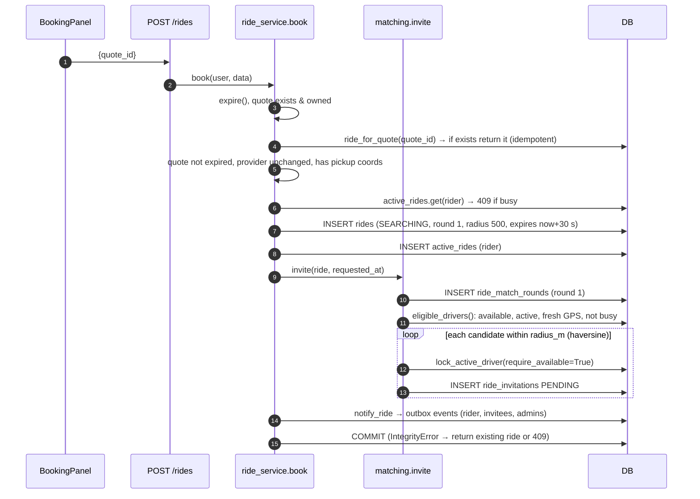
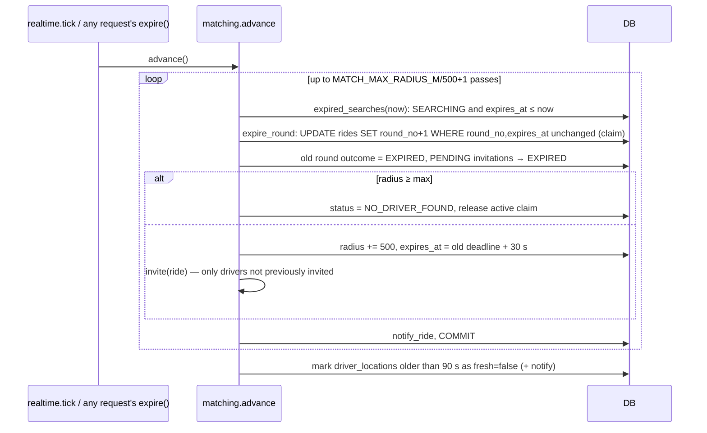
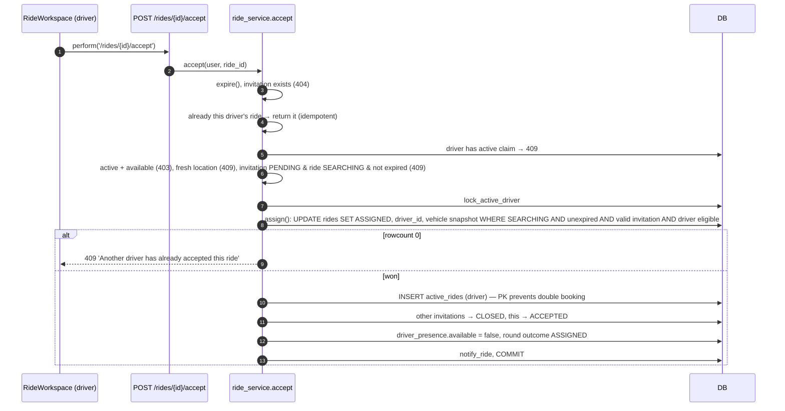
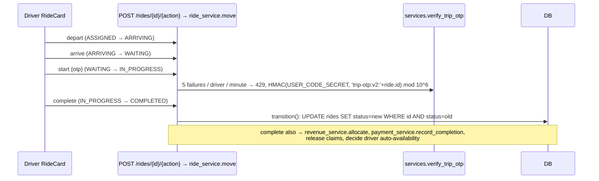
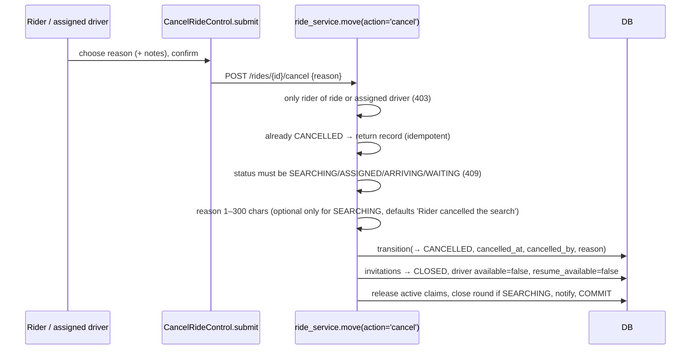
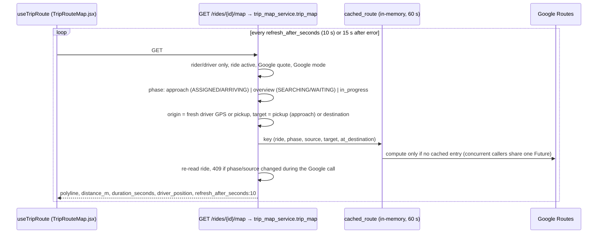

# Ride sequence diagrams

[← Back to index](../README.md) · Details: [09 — Features](../09-feature-by-feature-explanation.md), [10 — Data flow](../10-complete-data-flow.md)

## Driver goes available and streams GPS

## Fare quote

## Booking and matching round 1

## Round expiry (background worker or any request)

## Driver accepts

## Trip progression and OTP

## Cancellation

## Live trip map

