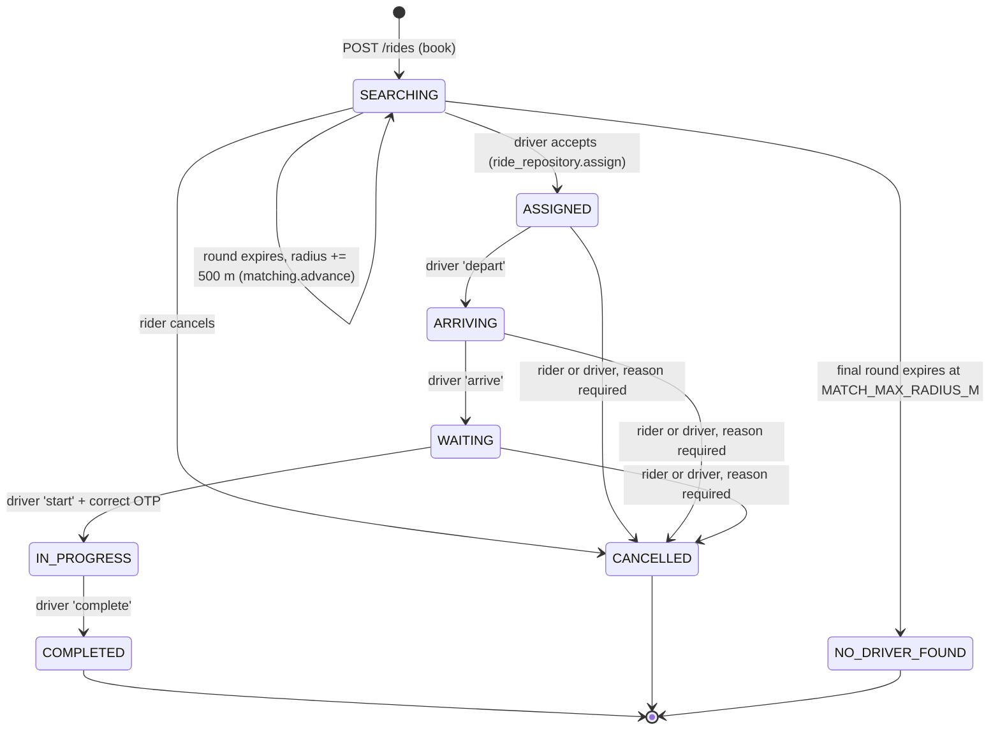
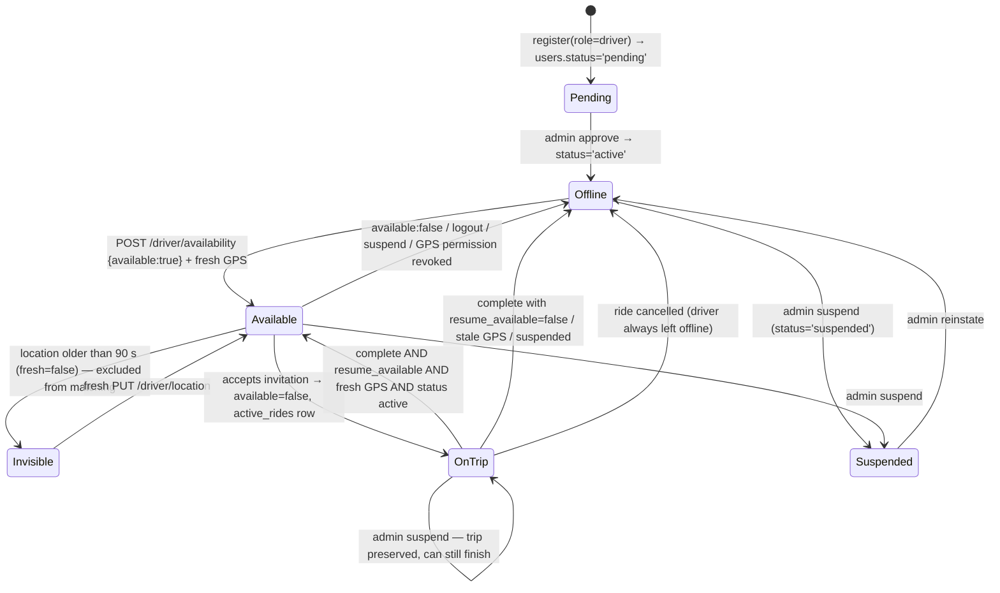
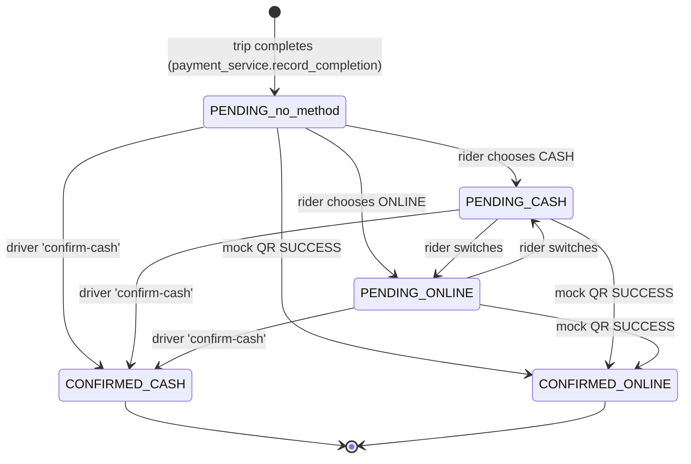
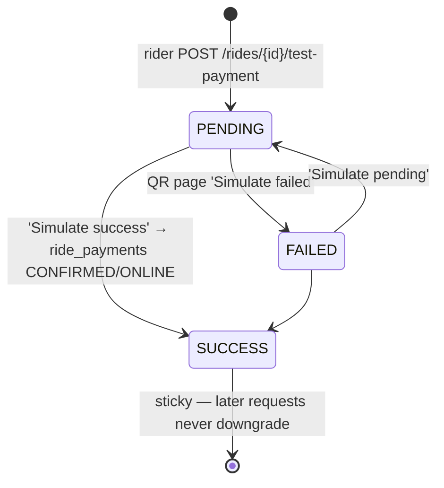
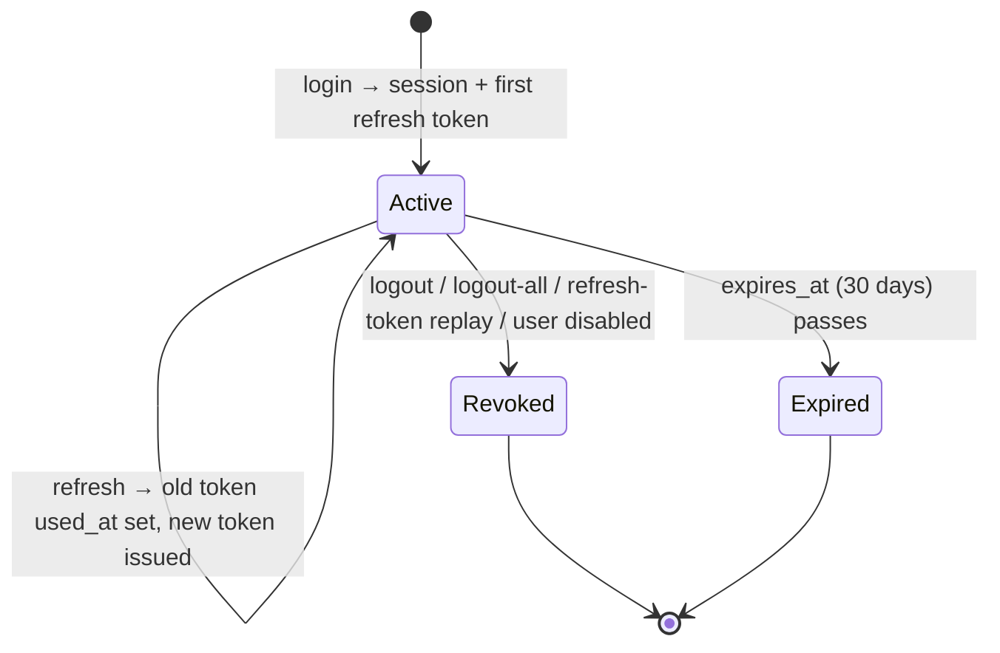

# State machines

[← Back to index](../README.md)

## Ride status (`rides.status`)

Allowed values are enforced by the `valid_ride_state` CHECK constraint. Transitions are implemented in `backend/app/ride_service.py` (`book`, `accept`, `move`) and `backend/app/matching.py` (`advance`). Every transition except the `NO_DRIVER_FOUND` timeout is a **conditional UPDATE** (`ride_repository.transition` / `ride_repository.assign`) so that only one concurrent request can win.

`IN_PROGRESS` rides **cannot be cancelled** (HTTP 409). There is no incident/abort workflow for an in-progress trip.

## Invitation status (`ride_invitations.status`)

No CHECK constraint; values are set in code.

```mermaid
stateDiagram-v2
  [*] --> PENDING : matching.invite()
  PENDING --> ACCEPTED : this driver accepts
  PENDING --> CLOSED : another driver accepts / ride cancelled / driver logs out or is suspended
  PENDING --> REJECTED : driver rejects
  PENDING --> EXPIRED : round deadline passes (matching.advance)
  PENDING --> OFFLINE : driver sets available=false
```

## Driver operational state (derived, not a single column)

There is **no driver-state enum** in the database. A driver's operational state is derived from four sources: `users.status`, `driver_presence.available`, `driver_presence.resume_available`, `active_rides`, and the freshness of `driver_locations`.

## Ride payment (`ride_payments`)

`CONFIRMED` is final. The first confirmation wins because `payment_service.confirm` updates only `WHERE status='PENDING'`. A third method, `UNRECORDED`, only exists for rides completed **before** payment tracking was added (back-filled by migration `7ba01cddd40c`).

## Mock QR payment (`mock_payments`)

## Auth session (`auth_sessions` + `refresh_tokens`)

